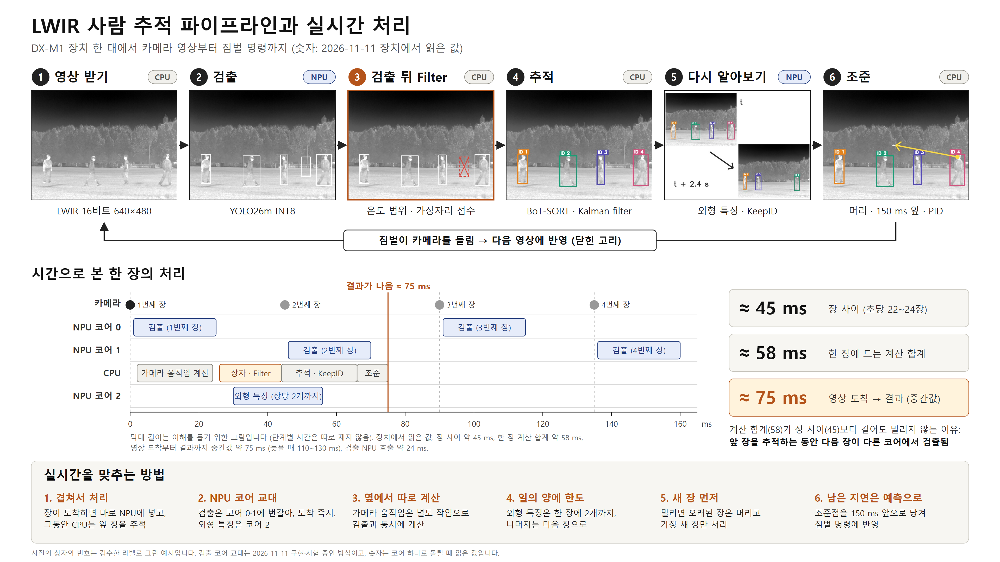

# LWIR 모델 뱅크

열화상(LWIR) 카메라로 **사람을 찾고 따라가는** 팀 프로젝트의 서버 두 개와, 그 서버가 쓰는 모델 파일을 모아 둔 저장소입니다. 장치는 DX-M1(Orange Pi 5 Plus) 한 대입니다.



> 그림의 숫자는 2026-11-11 에 장치에서 짧게 읽은 값입니다. 검출을 NPU 코어 0·1 에 번갈아 넣는 방식은 시험 중이며, 지금 기본은 코어 0 하나입니다. 자세한 설명은 [tracking_server/README.md](tracking_server/README.md)에 있습니다.

## 1. 들어 있는 것

| 폴더 | 무엇 | 포트 | 안내 |
|---|---|---|---|
| [`tracking_server/`](tracking_server/) | 실시간 추적 서버: 영상에서 사람을 찾아 번호를 붙이고 짐벌로 따라감. 웹 화면과 PC GUI 연결 | 8090 | [README](tracking_server/README.md) |
| [`label_server/`](label_server/) | 라벨 서버: 녹화에 붙인 사람 상자를 브라우저에서 고치는 사이트 | 8770 | [README](label_server/README.md) |

## 2. 빠른 시작 (추적 서버)

```bash
git clone https://github.com/lwir-deepx-tracking-system/model-bank.git
bash model-bank/tracking_server/scripts/setup.sh         # 한 번만: 빌드, 모델 연결과 확인
bash model-bank/tracking_server/scripts/run_real_gui.sh  # 켜기
```

브라우저에서 `http://<장치 주소>:8090/` 을 엽니다. 준비물, 설정, 끄는 법은 [tracking_server/README.md](tracking_server/README.md)에 있습니다.

`detect/yolo26x/yolo26x.pt` 는 Git LFS 파일입니다. 이 파일이 필요하면 `git lfs install` 뒤에 clone 하세요.

## 3. 무엇이 어디에 있나

폴더 이름은 밖에서 안으로 `서버 / 종류 / 일` 순서입니다. 일 이름은 어디서든 같습니다: `detect`(검출), `track`(추적), `reid`(외형 비교).

| 찾는 것 | 있는 곳 |
|---|---|
| 검출 모델 파일 (YOLO26, YOLOv8, YOLOX) | [`tracking_server/models/detect/`](tracking_server/models/detect/) |
| 외형 비교(re-ID) 모델 파일 | [`tracking_server/models/reid/`](tracking_server/models/reid/) |
| 추적에 쓰는 작은 파일 (확인 판정기, 번호 잇기 판정기, 위치 기억) | [`tracking_server/models/track/`](tracking_server/models/track/) |
| 모델별 입력·출력·학습 자료·측정값 | [`tracking_server/models/README.md`](tracking_server/models/README.md) |
| 모델 파일 확인값(sha256) | [`tracking_server/models/MANIFEST.json`](tracking_server/models/MANIFEST.json) |
| 추적 서버를 켜는 파일 | [`tracking_server/start_tracking_server.py`](tracking_server/start_tracking_server.py) |
| 추적 서버 코드 (일별 폴더) | [`tracking_server/src/`](tracking_server/src/) |
| 카메라 프로그램 | [`tracking_server/src/camera/`](tracking_server/src/camera/) |
| 짐벌 제어 프로그램, 팀 코드 사본, 제어값 기록 | [`tracking_server/src/gimbal/`](tracking_server/src/gimbal/) |
| 8090 웹 화면 | [`tracking_server/page/`](tracking_server/page/) |
| 준비·켜기·다시 켜기 스크립트 | [`tracking_server/scripts/`](tracking_server/scripts/) |
| 라벨 서버 전부 | [`label_server/`](label_server/) |

## 4. 모델

추적 서버 화면에서 고를 수 있는 모델입니다. 파일 경로는 `tracking_server/models/` 아래입니다. 입력·출력 모양과 측정값은 [models/README.md](tracking_server/models/README.md)에 있습니다.

**검출 (사람 찾기)**

| 화면 이름 | 파일 | 입력 | 학습 자료 | 상태 |
|---|---|---|---|---|
| YOLO26m_(FLIR) 640x480 | `detect/yolo26m/yolo26m_flir_nms_640x480.dxnn` | 640×480 | FLIR | **시작 모델** |
| YOLO26m_(FLIR) 640x640 | `detect/yolo26m/yolo26m_flir_nms_640x640.dxnn` | 640×640 | FLIR | 고를 수 있음 |
| YOLO26s 640x480 | `detect/yolo26s/yolo26s_nms_640x480.dxnn` | 640×480 | FLIR | 고를 수 있음 |
| YOLO26s 640x640 | `detect/yolo26s/yolo26s_nms_640x640.dxnn` | 640×640 | FLIR | 고를 수 있음 |
| yolo26s_nmsfree_npu_640x640 | `detect/yolo26s/yolo26s_nmsfree_npu_640x640.dxnn` | 640×640 | FLIR | 고를 수 있음 |
| 실내 fine-tuning (11-10 17:42) | `detect/yolo26m/yolo26m_flir_inside_20261110_1742_640x480.dxnn` | 640×480 | 우리 카메라 실내 | 시험용, 실내 전용 |
| 실내 fine-tuning (11-10 20:20) | `detect/yolo26m/yolo26m_flir_inside_20261110_2020_640x480.dxnn` | 640×480 | 우리 카메라 실내 | 시험용, 실내 전용 |
| 실내 fine-tuning patch (11-11) | `detect/yolo26m/yolo26m_flir_inside_20261111_patch_640x480.dxnn` | 640×480 | 우리 카메라 실내 + 사람 아닌 조각 | 시험용, 실내 전용 |
| 실외 fine-tuning patch (11-10) | `detect/yolo26m/yolo26m_flir_outside_20261110_patch_640x480.dxnn` | 640×480 | 우리 카메라 실외 | 시험용, 실외 실시간 시험 대기 |

**외형 비교 (같은 사람인지 확인)**

| 화면 이름 | 파일 | 학습 자료 | 상태 |
|---|---|---|---|
| RepVGG_distillation_(TMOT,CAMEL)_20261103 | `reid/repvgg_tmot_camel_reid.dxnn` | 공개 열화상 자료 | **시작 모델** |
| RepVGG_distillation_(실내)_20261110 | `reid/repvgg_distill_inside_20261110_reid.dxnn` | 우리 카메라 실내 | 시험용 |
| RepVGG_fine-tuning_(실내)_20261110 | `reid/repvgg_ft_inside_20261110_reid.dxnn` | 우리 카메라 실내 | 시험용 |
| ViT-lite_distillation_(실내)_20261111 | `reid/vit_lite_distill_inside_20261111_reid.dxnn` | 우리 카메라 실내 | 시험용 |
| ViT-lite_fine-tuning_(실내)_20261111 | `reid/vit_lite_ft_inside_20261111_reid.dxnn` | 우리 카메라 실내 | 시험용 |

- 외형 비교 모델의 입력은 128×64 사람 조각, 출력은 숫자 128개입니다.
- "시험용" 모델은 장치에서 정확도를 재지 않았습니다.
- 목록에 없는 파일(YOLOv8, YOLOX, YOLO26x PT)은 `detect/` 아래 같은 이름의 폴더에 있습니다.

## 5. 옛 경로로 찾아온 분께 (2026-11-11 에 옮김)

<details>
<summary>옛 자리 → 새 자리 표 (새 자리는 모두 <code>tracking_server/</code> 아래)</summary>

| 옛 자리 | 새 자리 |
|---|---|
| `yolo26/yolo26m_flir_nms_*.dxnn` | `models/detect/yolo26m/` |
| `yolo26/yolo26m_flir_inside_nms_640x480.dxnn` | `models/detect/yolo26m/yolo26m_flir_inside_20261110_2020_640x480.dxnn` (같은 파일, 이름에 날짜·시각) |
| `yolo26/yolo26s_*.dxnn` | `models/detect/yolo26s/` |
| `yolo26/yolo26x.pt`, `yolo26x_train_metadata.json` | `models/detect/yolo26x/` |
| `yolo26/*_build/` | `models/detect/build_scripts/` |
| `yolov8/`, `yolox/` | `models/detect/yolov8/`, `models/detect/yolox/` |
| `final_tracker/dxnn/repvgg_tmot_camel_reid.dxnn` | `models/reid/` |
| `final_tracker/dxnn/yolo26m_flir_whole480_nms_640x480.dxnn` | 없앰. 같은 파일이 `models/detect/yolo26m/yolo26m_flir_nms_640x480.dxnn` |
| `final_tracker/dxnn/yolo26m_flir_rt480_*_nms_480x384.dxnn` (타일 2장) | 없앰 |
| `final_tracker/compile_metadata/` | 모델 파일 옆 |
| `final_tracker/tracker/lwir_tracker_m1.py` | `start_tracking_server.py` + `src/` |
| `final_tracker/tracker/native_post.py`, `post.cpp` | `src/detect/` |
| `final_tracker/tracker/relabel_online.py`, `relink_online_judge.py` | `src/reid/` |
| `final_tracker/tracker/cam_pipe.cpp` | `src/camera/` |
| `final_tracker/tracker/live_page.html` | `page/` |
| `final_tracker/tracker/gate_gru32_frozen.json`, `relink_judge_frozen.json` | `models/track/` |
| `final_tracker/tracker/setup.sh`, `run/` | `scripts/` |
| `final_tracker/tracker/models/MANIFEST.json` | `models/MANIFEST.json` |
| `final_tracker/gimbal/` | `src/gimbal/` |
| `final_tracker/reid_gru_io.md` | `models/reid/README.md`, `models/track/README.md` |
| `final_tracker/README.md` | `README.md` |
| `tensor_requirements.md` | 없앰. 모델별 입력·출력은 `models/README.md` |
| 옛 그림 (`final_tracker/images/` 의 4장) | 없앰. 지금 그림은 `images/pipeline_realtime_20261111.png` 한 장 |

</details>

없앤 파일과 옛 README 의 긴 기록(지난 측정표, 지운 모델의 기록, 옛 그림)은 **git 기록에 남아 있습니다.** 옛 커밋을 checkout 하면 그대로 받을 수 있습니다.

## 6. 주의

- 이 저장소는 **공개**입니다. 키, 장치 주소, 카메라 영상, 라벨 자료는 올리지 않습니다.
- 추적 서버 화면에는 비밀번호가 없고 짐벌을 움직입니다. 믿을 수 있는 기기만 닿는 주소에서 쓰세요.
- NPU 측정 프로그램을 돌리기 전에는 추적 서버를 먼저 꺼 주세요([끄는 법](tracking_server/README.md#6-꺼지면-다시-켜기-끄기)).
