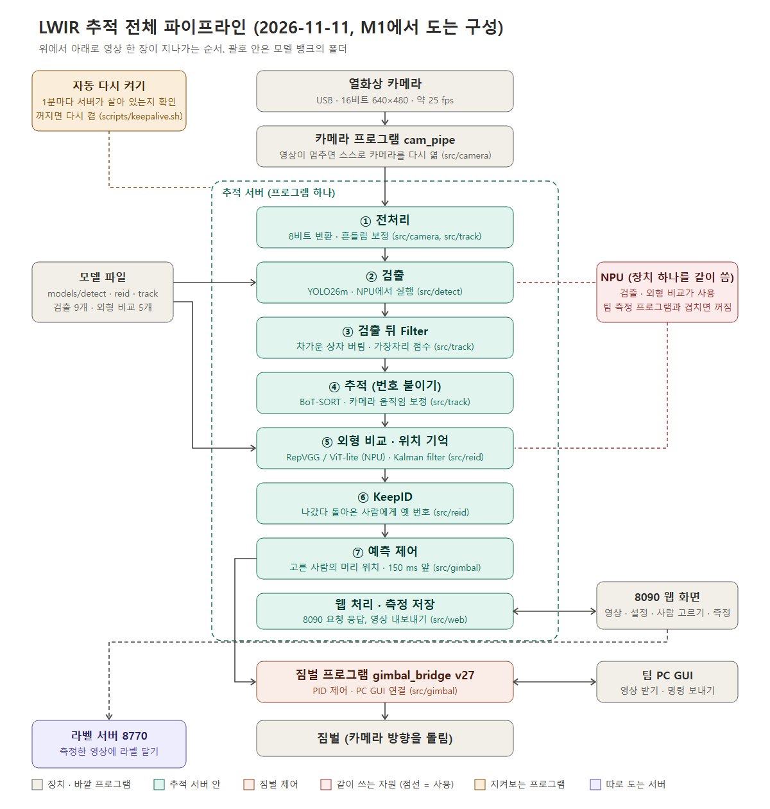

# LWIR 모델 뱅크

열화상(LWIR) 카메라로 사람을 찾고 따라가는 팀 프로젝트의 **서버 두 개와 그 서버가 쓰는 모델 파일**을 모아 둔 저장소입니다. 장치는 DX-M1(Orange Pi 5 Plus)입니다.

| 폴더 | 무엇 | 포트 | 안내 |
| --- | --- | --- | --- |
| [`tracking_server/`](tracking_server/) | 실시간 추적 서버: 카메라 영상에서 사람을 찾아 번호를 붙이고, 웹 화면·짐벌·PC GUI 와 연결 | 8090 | [tracking_server/README.md](tracking_server/README.md) |
| [`label_server/`](label_server/) | 라벨 서버: 녹화에 붙인 사람 상자를 브라우저에서 고치는 사이트 | 8770 | [label_server/README.md](label_server/README.md) |

폴더 이름은 `서버 이름 / 종류 / 일` 순서입니다. 일 이름(`detect` 검출, `track` 추적, `reid` 외형 비교)은 모델 폴더와 코드 폴더에서 같습니다.

## 무엇이 어디에 있나

| 찾는 것 | 있는 곳 |
| --- | --- |
| 검출 모델 파일 (YOLO26, YOLOv8, YOLOX) | [`tracking_server/models/detect/`](tracking_server/models/detect/) 아래 구조별 폴더 |
| 외형 비교(re-ID) 모델 파일 | [`tracking_server/models/reid/`](tracking_server/models/reid/) |
| 추적에 쓰는 작은 모델 (확인 판정기, 번호 잇기 판정기, 위치 기억) | [`tracking_server/models/track/`](tracking_server/models/track/) |
| 모델별 입력·출력·학습 자료·측정값 | [`tracking_server/models/README.md`](tracking_server/models/README.md) |
| 모델 파일 확인값(sha256) | [`tracking_server/models/MANIFEST.json`](tracking_server/models/MANIFEST.json) |
| 검출 모델을 만든 스크립트 | [`tracking_server/models/detect/build_scripts/`](tracking_server/models/detect/build_scripts/) |
| 추적 서버를 켜는 파일 | [`tracking_server/start_tracking_server.py`](tracking_server/start_tracking_server.py) |
| 추적 서버 코드 (일별 폴더) | [`tracking_server/src/`](tracking_server/src/) |
| 카메라 프로그램 | [`tracking_server/src/camera/cam_pipe.cpp`](tracking_server/src/camera/cam_pipe.cpp) |
| 짐벌·PC GUI 프로그램, 팀 코드 사본, 제어값 기록 | [`tracking_server/src/gimbal/`](tracking_server/src/gimbal/) |
| 웹 화면과 그 조각, 만들기 도구 | [`tracking_server/page/`](tracking_server/page/) |
| 장치 준비·켜기·다시 켜기 스크립트 | [`tracking_server/scripts/`](tracking_server/scripts/) |
| 라벨 서버 전부 | [`label_server/`](label_server/) |

## 모델 한눈에 보기

추적 서버 화면의 목록에 나오는 모델입니다. 입력은 모두 uint8, 출력은 float32 입니다. 자세한 표와 나머지 파일(YOLOv8, YOLOX, YOLO26x PT, 판정기, 위치 기억)은 [models/README.md](tracking_server/models/README.md)에 있습니다.

| 화면 이름 | 파일 (`tracking_server/models/` 아래) | 입력 | 출력 | 학습 자료 | 상태 |
| --- | --- | --- | --- | --- | --- |
| YOLO26m_(FLIR) 640x480 | `detect/yolo26m/yolo26m_flir_nms_640x480.dxnn` | 640×480 | 분할 출력 6개 (60·30·15) | FLIR 10,491장 | 켜기 스크립트의 시작 모델 |
| YOLO26s 640x480 | `detect/yolo26s/yolo26s_nms_640x480.dxnn` | 640×480 | 분할 출력 6개 (60·30·15) | FLIR 10,742장 | 고를 수 있음. 장치 정확도 미측정 |
| YOLO26m_(FLIR) 640x640 | `detect/yolo26m/yolo26m_flir_nms_640x640.dxnn` | 640×640 | 분할 출력 6개 (80·40·20) | FLIR 10,491장 | 고를 수 있음 |
| YOLO26s 640x640 | `detect/yolo26s/yolo26s_nms_640x640.dxnn` | 640×640 | 분할 출력 6개 (80·40·20) | FLIR 10,742장 | 고를 수 있음 |
| 실내 fine-tuning 이전 판 (11-10 17:42) | `detect/yolo26m/yolo26m_flir_inside_20261110_1742_640x480.dxnn` | 640×480 | 분할 출력 6개 (60·30·15) | 우리 카메라 실내 | 시험용, 실내 전용. 장치 정확도 미측정 |
| 실내 fine-tuning 최신 판 (11-10 20:20) | `detect/yolo26m/yolo26m_flir_inside_20261110_2020_640x480.dxnn` | 640×480 | 분할 출력 6개 (60·30·15) | 우리 카메라 실내 | 시험용, 실내 전용. 장치 정확도 미측정 |
| 실외 fine-tuning patch 판 (11-10) | `detect/yolo26m/yolo26m_flir_outside_20261110_patch_640x480.dxnn` | 640×480 | 분할 출력 6개 (60·30·15) | 우리 카메라 실외 | 시험용. 실외 실시간 시험을 기다리는 중. 장치 정확도 미측정 |
| 실내 fine-tuning patch 판 (11-11) | `detect/yolo26m/yolo26m_flir_inside_20261111_patch_640x480.dxnn` | 640×480 | 분할 출력 6개 (60·30·15) | 우리 카메라 실내 + 사람 아닌 조각("모름") | 시험용 · 실내 전용. 장치 정확도 미측정 |
| yolo26s_nmsfree_npu_640x640 [NMS-free] | `detect/yolo26s/yolo26s_nmsfree_npu_640x640.dxnn` | 640×640 | `[1,300,6]` | FLIR 10,742장 | 고를 수 있음 |
| RepVGG_distillation_(TMOT,CAMEL)_20261103 | `reid/repvgg_tmot_camel_reid.dxnn` | 128×64 | `[1,128]` | 공개 열화상 자료 | 켜기 스크립트의 시작 모델 |
| RepVGG_distillation_(실내)_20261110 | `reid/repvgg_distill_inside_20261110_reid.dxnn` | 128×64 | `[1,128]` | 우리 카메라 실내 | 시험용. 장치 정확도 미측정 |
| RepVGG_fine-tuning_(실내)_20261110 | `reid/repvgg_ft_inside_20261110_reid.dxnn` | 128×64 | `[1,128]` | 우리 카메라 실내 | 시험용. 장치 정확도 미측정 |
| ViT-lite_distillation_(실내)_20261111 | `reid/vit_lite_distill_inside_20261111_reid.dxnn` | 128×64 | `[1,128]` | 우리 카메라 실내 | 시험용. 장치 정확도 미측정 |
| ViT-lite_fine-tuning_(실내)_20261111 | `reid/vit_lite_ft_inside_20261111_reid.dxnn` | 128×64 | `[1,128]` | 우리 카메라 실내 | 시험용. 장치 정확도 미측정 |

`detect/yolo26x/yolo26x.pt` 는 Git LFS 파일입니다(`git lfs install` 뒤 clone).

## 옮긴 경로 (2026-11-11)

옛 주소로 찾아온 분을 위한 표입니다. 새 자리는 모두 `tracking_server/` 아래입니다.

| 옛 자리 | 새 자리 |
| --- | --- |
| `yolo26/yolo26m_flir_nms_*.dxnn` (+ `_compile_metadata.json`) | `models/detect/yolo26m/` |
| `yolo26/yolo26m_flir_inside_nms_640x480.dxnn` | `models/detect/yolo26m/yolo26m_flir_inside_20261110_2020_640x480.dxnn` (같은 파일, 이름에 날짜·시각을 넣음) |
| `yolo26/yolo26s_*.dxnn` (+ `_compile_metadata.json`) | `models/detect/yolo26s/` |
| `yolo26/yolo26x.pt`, `yolo26x_train_metadata.json` | `models/detect/yolo26x/` |
| `yolo26/*_build/` | `models/detect/build_scripts/` |
| `yolov8/` | `models/detect/yolov8/` |
| `yolox/` | `models/detect/yolox/` |
| `final_tracker/dxnn/repvgg_tmot_camel_reid.dxnn` | `models/reid/` |
| `final_tracker/dxnn/yolo26m_flir_whole480_nms_640x480.dxnn` | 없앰. 같은 파일이 `models/detect/yolo26m/yolo26m_flir_nms_640x480.dxnn` 입니다 |
| `final_tracker/dxnn/yolo26m_flir_rt480_a_nms_480x384.dxnn`, `..._b_...` (타일 2장) | 없앰 |
| `final_tracker/compile_metadata/` | 남은 모델의 것은 모델 파일 옆 |
| `final_tracker/tracker/lwir_tracker_m1.py` | `start_tracking_server.py` + `src/` |
| `final_tracker/tracker/native_post.py`, `post.cpp` | `src/detect/` |
| `final_tracker/tracker/relabel_online.py`, `relink_online_judge.py` | `src/reid/` |
| `final_tracker/tracker/cam_pipe.cpp` | `src/camera/` |
| `final_tracker/tracker/live_page.html` | `page/` |
| `final_tracker/tracker/gate_gru32_frozen.json`, `relink_judge_frozen.json` | `models/track/` |
| `final_tracker/tracker/setup.sh`, `run/` | `scripts/` |
| `final_tracker/tracker/models/MANIFEST.json` | `models/MANIFEST.json` |
| `final_tracker/tracker/CHANGES_FROM_RESEARCH_SCRIPT.md` | `src/` |
| `final_tracker/gimbal/` | `src/gimbal/` |
| `final_tracker/images/` | `images/` |
| `final_tracker/reid_gru_io.md` | `models/reid/README.md`, `models/track/README.md` |
| `final_tracker/README.md` | `README.md` |
| `tensor_requirements.md` | 없앰. 모델별 입력·출력은 `models/README.md` |
| `final_tracker/tracker/test300/`, `post.so`, `models/*.dxnn` 3개, `models/profiler.json` (실행하다 생긴 파일) | 없앰. `post.so` 는 `scripts/setup.sh` 가 장치에서 빌드합니다 |

없앤 파일과 옛 README 의 긴 기록(지난 측정표, 지운 모델의 기록)은 **git 기록에 남아 있습니다.** 옛 커밋을 checkout 하면 그대로 받을 수 있습니다.

## 전체 흐름 그림

자세한 설명과 CPU / NPU / 거르는 곳 그림은 [tracking_server/README.md](tracking_server/README.md) 에 있습니다.
