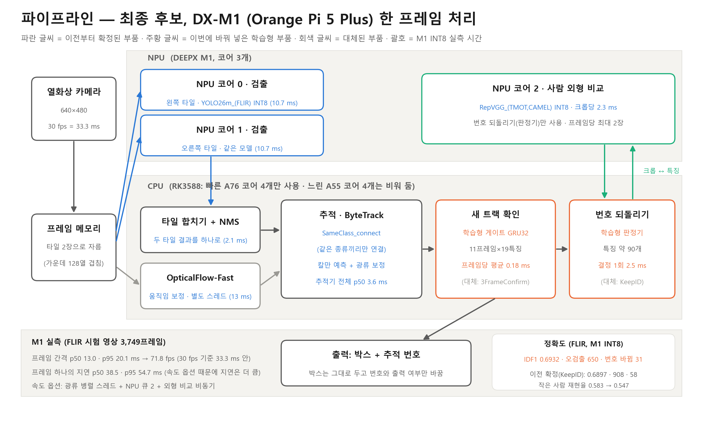
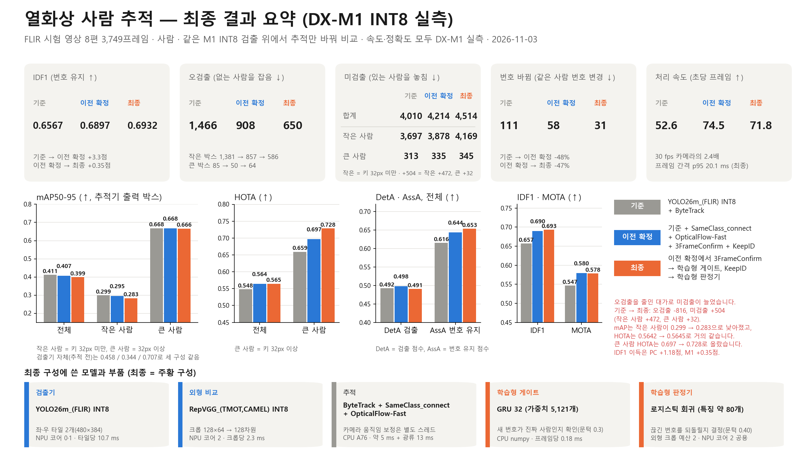

# 최종 추적 시스템 — 열화상 사람 추적 (DX-M1 INT8)

640×512 열화상 영상에서 **사람을 찾고, 같은 사람에게 같은 번호를 유지**해 줍니다. 이 폴더 안의 파일만 있으면 되고, 모델뱅크의 다른 폴더(`yolo26/`, `reid/` 등)는 쓰지 않습니다.

## 1. 쓰는 파일 (전부 필요)

| 파일 | 하는 일 | 도는 곳 |
| --- | --- | --- |
| `dxnn/yolo26m_flir_rt480_a.dxnn` | 사람 검출, 화면 왼쪽 타일 (열 0~384) | NPU 코어 0 |
| `dxnn/yolo26m_flir_rt480_b.dxnn` | 사람 검출, 화면 오른쪽 타일 (열 256~640) | NPU 코어 1 |
| `dxnn/repvgg_tmot_camel_reid.dxnn` | 사람 외형 비교 (끊겼던 사람에게 예전 번호를 돌려줄 때) | NPU 코어 2 |
| `tracker/` | 실행 코드와 학습된 게이트·판정기 (`lwir_tracker_m1.py`가 실행 파일) | CPU |
| `compile_metadata/` | 모델 컴파일 기록. 참고용이고 실행에는 필요 없음 | — |

- 세 DXNN은 모두 **INT8**입니다(입력 uint8, 출력 float32).
- 검출기 A와 B는 같은 가중치를 타일 위치별로 두 번 컴파일한 것이라 **둘 다** 있어야 합니다.



## 2. 준비물

- DX-M1(Orange Pi 5 Plus), DXRT 3.4.2. 확인한 환경: Ubuntu 22.04, Python 3.10, g++ 11.4.
- Python 패키지: numpy, opencv(cv2), scipy, `dx_engine`.
- **NPU가 비어 있어야 합니다.** 다른 NPU 작업이 돌고 있으면 시작 때 멈춥니다.
- 입력 영상은 **640×512, 8비트 흑백**이어야 합니다.

## 3. 설치 (한 번만)

```bash
git clone https://github.com/lwir-deepx-tracking-system/model-bank.git
cd model-bank/final_tracker/tracker
bash setup.sh
```

끝에 모델 세 개가 `OK`로 나오고 `setup done`이 보이면 됩니다. (`setup.sh`는 `post.so`를 빌드하고, 모델 파일을 연결하고, 파일이 맞는지 확인합니다.)

## 4. 실행

입력은 프레임 이미지가 들어 있는 폴더 하나입니다. 그 안에 `coco.json`이 있어야 하고, `images[]`마다 `id`, `file_name`(폴더 기준 상대 경로), `extra_info.video_id`(영상 구분. 영상이 바뀌면 추적이 새로 시작)가 들어 있으면 됩니다. 정답 박스는 필요 없습니다. 이미지는 `file_name` 순서로 처리합니다.

`final_tracker/tracker` 폴더에서 실행합니다.

```bash
python3 -B lwir_tracker_m1.py \
  --tracker bytetrack --no-vit --det rt480 --pipeline --preload \
  --class-gate --gmc --gmc-corners 300 --gmc-mindist 5 --n-init 3 \
  --relabel RVGGA0_REID2C256 --rl-async --gmc-thread --npu-depth 2 \
  --confirm-gate gate_gru32_frozen.json \
  --judge relink_judge_frozen.json --judge-crops 2 \
  --data /영상/프레임/폴더 --out 결과폴더이름
```

- `--data`는 필수이고, `--out`은 `tracker/` 아래에 새로 만들 폴더 이름입니다(이미 있으면 멈춥니다).
- 옵션은 그대로 복사해서 쓰면 최종 구성입니다. 각 옵션의 뜻은 루트 `README.md`의 4-4절에 있습니다.

## 5. 결과

`결과폴더/TRACKS.jsonl`이 최종 결과입니다. 한 줄이 한 프레임입니다.

```
{"image_id", "coco_image_id", "video_id", "tracker_reset",
 "tracks_xyxy_id_conf_class_detectionindex": [[x1, y1, x2, y2, 번호, 신뢰도, 클래스, 검출 번호], ...]}
```

- 좌표는 640×512 프레임 좌표이고, 번호는 영상 안에서만 유일합니다.
- 클래스는 0 = 사람, 2 = 차, 6 = 트럭입니다. 사람 번호만 게이트·판정기로 다듬습니다.
- `RESULT.json`에는 프레임 간격, 지연, 모델 해시, 사용한 옵션이 들어 있습니다.

## 6. 성능 (FLIR 시험 영상 8편 3,749프레임, 사람, DX-M1 INT8 실측)



| 구성 | IDF1 | 오검출 | 미검출 | 번호 바뀜 | 속도 |
| --- | --- | --- | --- | --- | --- |
| 기준: YOLO26m_(FLIR) INT8 + ByteTrack | 0.6567 | 1,466 | 4,010 | 111 | 52.6 fps |
| 이전 확정: + SameClass_connect + OpticalFlow-Fast + 3FrameConfirm + KeepID | 0.6897 | 908 | 4,214 | 58 | 74.5 fps |
| **최종 (이 폴더)**: 게이트 + 판정기 | 0.6932 | 650 | 4,514 | 31 | 71.8 fps |

## 7. 꼭 알아둘 것

- 오검출과 번호 바뀜은 줄지만 **미검출이 늘어납니다**(늘어난 504건 중 472건이 키 32px 미만의 작은 사람). IDF1 이득은 +0.35점으로 작고 통계적으로 확정되지 않았습니다.
- 게이트와 판정기는 고정 교차로 영상(5~9 fps)으로 학습했습니다. 다른 카메라·프레임률에서 같은 이득이 난다는 보장은 없습니다.
- 프레임 하나의 지연은 p50 38.5 ms, p95 54.7 ms로 30 fps 조건(33 ms)을 만족하지 않습니다. 처리량(프레임 간격 p95 20.1 ms)은 만족합니다.
- 정답이 없는 영상에서는 결과가 맞는지 확인할 방법이 없으니 결과를 정답으로 쓰지 마십시오.

자세한 근거와 한계는 루트 `README.md`의 4절과 "상세 근거"에 있습니다.
