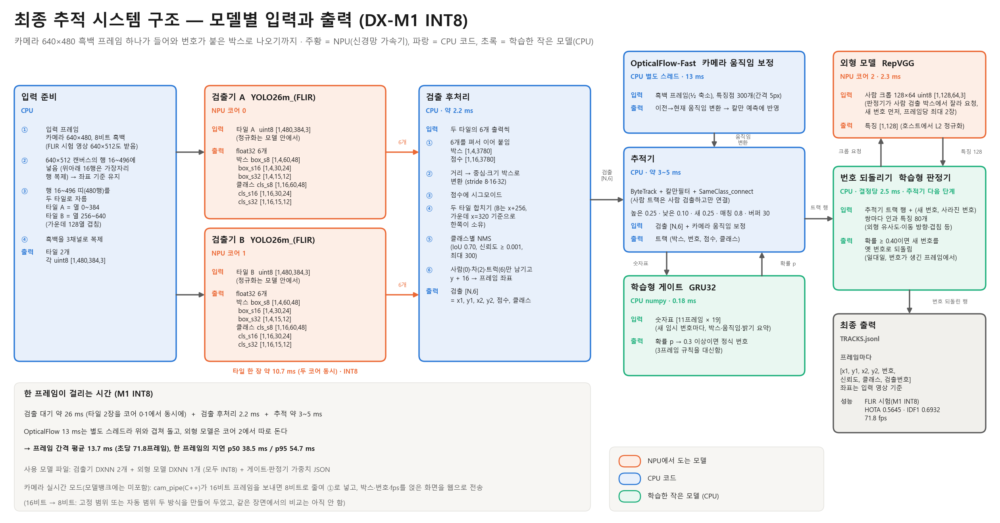
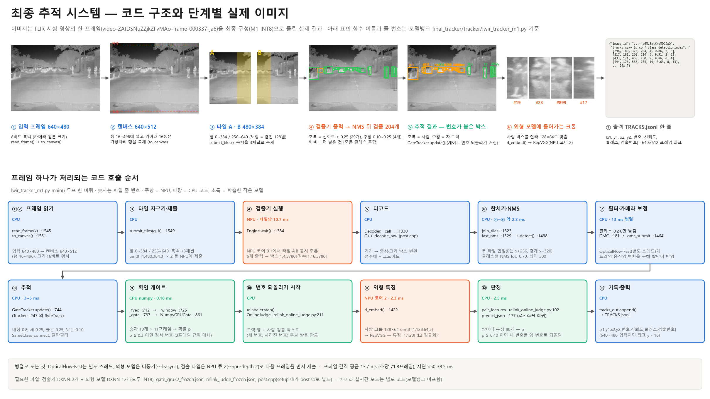

# 최종 추적 시스템 — 열화상 사람 추적 (DX-M1 INT8)

카메라의 640×480 열화상 영상에서 **사람을 찾고, 같은 사람에게 같은 번호를 유지**해 줍니다. 이 폴더 안의 파일만 있으면 되고, 모델뱅크의 다른 폴더(`yolo26/`, `reid/` 등)는 쓰지 않습니다.

## 1. 쓰는 파일 (전부 필요)

| 파일 | 하는 일 | 도는 곳 |
| --- | --- | --- |
| `dxnn/yolo26m_flir_rt480_a_nms_480x384.dxnn` | 사람 검출, 화면 왼쪽 타일 (열 0~384) | NPU 코어 0 |
| `dxnn/yolo26m_flir_rt480_b_nms_480x384.dxnn` | 사람 검출, 화면 오른쪽 타일 (열 256~640) | NPU 코어 1 |
| `dxnn/repvgg_tmot_camel_reid.dxnn` | 사람 외형 비교 (끊겼던 사람에게 예전 번호를 돌려줄 때) | NPU 코어 2 |
| `tracker/` | 실행 코드와 학습된 게이트·판정기 (`lwir_tracker_m1.py`가 실행 파일) | CPU |
| `compile_metadata/` | 모델 컴파일 기록. 참고용이고 실행에는 필요 없음 | — |

- 세 DXNN은 모두 **INT8**입니다(입력 uint8, 출력 float32).
- 검출기 A와 B는 같은 가중치를 타일 위치별로 두 번 컴파일한 것이라 **둘 다** 있어야 합니다.
- 검출기의 출력은 `tensor_requirements.md`의 YOLO26 분할 출력 6개(박스 3개 + 클래스 3개, C = 16)입니다. 실행 코드가 이를 알아서 합칩니다(`--no-split6`은 예전 두 출력 DXNN용).


모델별 입력과 출력, 장치, 시간은 아래 그림에 정리했습니다.



실시간 서버(8절)에서 검출기를 바꿀 때만 쓰는 파일은 다음과 같습니다.

| 파일 | 하는 일 | 도는 곳 |
| --- | --- | --- |
| `dxnn/yolo26m_flir_whole480_nms_640x480.dxnn` | 사람 검출, 타일로 자르지 않은 640×480 한 장 | NPU 코어 0 |
| `tracker/cam_pipe.cpp` | 카메라 원본을 읽어 추적기로 넘기는 프로그램 (`setup.sh`가 빌드) | CPU |

## 2. 준비물

- DX-M1(Orange Pi 5 Plus), DXRT 3.4.2. 확인한 환경: Ubuntu 22.04, Python 3.10, g++ 11.4.
- Python 패키지: numpy, opencv(cv2), scipy, `dx_engine`.
- **NPU가 비어 있어야 합니다.** 다른 NPU 작업이 돌고 있으면 시작 때 멈춥니다.
- **입력 영상은 640×480, 8비트 흑백(카메라 원본 크기)이 표준입니다.** FLIR 시험 영상 같은 640×512 8비트 흑백도 받습니다(검증한 형태). 그 밖의 크기, 16비트 영상, 크기가 섞인 입력은 어느 프레임이 왜 안 되는지 알려 주고 멈춥니다.
  - 안에서는 640×480 프레임을 640×512 캔버스의 가운데(행 16~496)에 넣고, 위아래 16행은 첫 행·마지막 행으로 채웁니다. 타일, 좌표 기준, 학습한 설정이 FLIR 시험에서 검증한 것과 같아집니다.
  - 16비트 카메라 원본은 먼저 8비트로 줄여야 합니다(이 코드는 줄이지 않습니다).
## 3. 설치 (한 번만)

```bash
git clone https://github.com/lwir-deepx-tracking-system/model-bank.git
cd model-bank/final_tracker/tracker
bash setup.sh
```

끝에 모델 네 개가 `OK`로 나오고 `setup done`이 보이면 됩니다. (`setup.sh`는 `post.so`를 빌드하고, 모델 파일을 연결하고, 파일이 맞는지 확인합니다. 카메라 SDK가 있으면 실시간 서버용 `cam_pipe`도 빌드합니다.)

## 4. 실행

입력은 프레임 이미지가 들어 있는 폴더 하나입니다. 그 안에 `coco.json`이 있어야 하고, `images[]`마다 `id`, `file_name`(폴더 기준 상대 경로), `extra_info.video_id`(영상 구분. 영상이 바뀌면 추적이 새로 시작)가 들어 있으면 됩니다. 정답 박스는 필요 없습니다. 이미지는 `file_name` 순서로 처리합니다.

`final_tracker/tracker` 폴더에서 실행합니다.

```bash
python3 -B lwir_tracker_m1.py \
  --tracker bytetrack --no-vit --det rt480 --pipeline --preload \
  --class-gate --gmc --gmc-corners 300 --gmc-mindist 5 --n-init 3 \
  --relabel RVGGA0_REID2C256 --rl-async --gmc-thread --npu-depth 2 \
  --confirm-gate gate_gru32_frozen.json \
  --judge relink_judge_frozen.json --judge-crops 2 \
  --data /영상/프레임/폴더 --out 결과폴더이름
```

- `--data`는 필수이고, `--out`은 `tracker/` 아래에 새로 만들 폴더 이름입니다(이미 있으면 멈춥니다).
- 옵션은 그대로 복사해서 쓰면 최종 구성입니다. 각 옵션의 뜻은 루트 `README.md`의 4-4절에 있습니다.

## 5. 결과

`결과폴더/TRACKS.jsonl`이 최종 결과입니다. 한 줄이 한 프레임입니다.

```
{"image_id", "coco_image_id", "video_id", "tracker_reset",
 "tracks_xyxy_id_conf_class_detectionindex": [[x1, y1, x2, y2, 번호, 신뢰도, 클래스, 검출 번호], ...]}
```

- 좌표는 **입력 영상 기준**입니다(640×480 입력이면 640×480 영상의 좌표, 640×512 입력이면 640×512 영상의 좌표). 번호는 영상 안에서만 유일합니다.
- 클래스는 0 = 사람, 2 = 차, 6 = 트럭입니다. 사람 번호만 게이트·판정기로 다듬습니다.
- `RESULT.json`에는 프레임 간격, 지연, 모델 해시, 사용한 옵션이 들어 있습니다.

## 코드 구조 (한 프레임의 처리 순서)

실제 FLIR 시험 영상 한 프레임이 단계마다 어떻게 바뀌는지와, 각 단계를 맡은 함수 이름·줄 번호를 보여 줍니다(줄 번호는 `tracker/lwir_tracker_m1.py` 기준).



## 6. 성능 (FLIR 시험 영상 8편 3,749프레임, 사람, DX-M1 INT8 실측)


| 구성 | IDF1 | 오검출 | 미검출 | 번호 바뀜 | 속도 |
| --- | --- | --- | --- | --- | --- |
| 기준: YOLO26m_(FLIR) INT8 + ByteTrack | 0.6567 | 1,466 | 4,010 | 111 | 52.6 fps |
| 이전 확정: + SameClass_connect + OpticalFlow-Fast + 3FrameConfirm + KeepID | 0.6897 | 908 | 4,214 | 58 | 74.5 fps |
| **최종 (이 폴더)**: 게이트 + 판정기 | 0.6932 | 650 | 4,514 | 31 | 71.8 fps |

## 7. 꼭 알아둘 것

- 오검출과 번호 바뀜은 줄지만 **미검출이 늘어납니다**(늘어난 504건 중 472건이 키 32px 미만의 작은 사람). IDF1 이득은 +0.35점으로 작고 통계적으로 확정되지 않았습니다.
- 게이트와 판정기는 고정 교차로 영상(5~9 fps)으로 학습했습니다. 다른 카메라·프레임률에서 같은 이득이 난다는 보장은 없습니다.
- 프레임 하나의 지연은 p50 38.5 ms, p95 54.7 ms로 30 fps 조건(33 ms)을 만족하지 않습니다. 처리량(프레임 간격 p95 20.1 ms)은 만족합니다.
- 정답이 없는 영상에서는 결과가 맞는지 확인할 방법이 없으니 결과를 정답으로 쓰지 마십시오.

자세한 근거와 한계는 루트 `README.md`의 4절과 "상세 근거"에 있습니다.

## 8. 실시간 서버 (카메라 + 웹 화면)

카메라 영상을 실시간으로 추적하고 결과를 웹 페이지로 보여 줍니다. 화면에는 사람(초록색 상자와 번호)만 그립니다. 차와 트럭도 추적은 하지만 그리지 않습니다.

**아직 없는 것:** 웹에서 사람을 클릭해 따라가기, 짐벌 제어, PC GUI(`pc-application`) 연결은 들어 있지 않습니다. 지금 웹 페이지는 보기 전용입니다.

### 추가 준비물

- i3system 열화상 카메라(640×480, 16비트, USB)와 카메라 SDK(`/usr/local/include/i3system`, `libi3system_*`). `setup.sh`가 SDK를 찾으면 `cam_pipe`를 빌드합니다. 없으면 파일 실행만 됩니다.

### 실행

`final_tracker/tracker` 폴더에서 실행합니다. 아래 명령은 검출기가 `yolo26m_flir_whole480_nms_640x480` 한 장인 구성입니다. 실제 카메라로 서버 화면을 확인한 구성은 `s640`이고, 이 명령 그대로 실제 카메라에서 돌려 보지는 않았습니다.

```bash
python3 -B lwir_tracker_m1.py \
  --tracker bytetrack --no-vit --det w480 --pipeline \
  --class-gate --gmc --gmc-corners 300 --gmc-mindist 5 --n-init 3 \
  --relabel RVGGA0_REID2C256 --rl-async --gmc-thread --npu-depth 1 \
  --confirm-gate gate_gru32_frozen.json \
  --judge relink_judge_frozen.json --judge-crops 2 \
  --live-port 8090 --live-bind <M1 주소> --live-seconds 28800 --out 결과폴더이름
```

브라우저에서 `http://<M1 주소>:8090/`을 엽니다. `--data`는 필요 없습니다.

| 옵션 | 뜻 |
| --- | --- |
| `--det` | 검출기. `rt480` = YOLO26m_(FLIR) 타일 2장(코어 0·1), `w480` = YOLO26m_(FLIR) 한 장(코어 0), `s640` = YOLO26s 한 장(코어 0, DXNN 파일이 모델뱅크에 없어 직접 넣어야 함) |
| `--live-port` | 웹 페이지 포트. 주지 않으면 파일 실행입니다 |
| `--live-bind` | 웹 페이지 주소. **페이지에 비밀번호가 없습니다.** 기본값 `127.0.0.1`은 이 장치에서만 열리니, 다른 컴퓨터에서 보려면 믿을 수 있는 망의 주소를 줍니다 |
| `--live-seconds` | 실행 시간(초). 기본 600 |
| `--live-map` | 16비트 → 8비트 변환. `pct`(기본) = 밝기 1~99% 구간을 천천히 따라감, `fixed` = 0~65535 고정 |
| `--live-scale` | 화면 배율. 기본 1.5 |

화면 윗줄의 뜻은 다음과 같습니다.

- `TRACK`, `CAM`: 추적 처리와 카메라의 초당 프레임 수
- `delay`: 카메라 프레임을 받은 뒤 화면에 그리기까지의 시간
- `compute`: 프레임 제출부터 추적 끝까지의 시간. `delay`와 함께 **다음 카메라 프레임을 기다리는 시간이 들어 있어** 순수 계산 시간이 아닙니다
- `persons`: 지금 화면의 사람 수, `newID`: 지금까지 새로 만든 사람 번호 수, `relink`: 판정기가 예전 번호로 되돌린 수

`--live-seconds`가 지나면 스스로 끝나고 결과 파일을 남깁니다. 메모리를 아끼려고 오래된 기록은 버리므로 마지막 부분만 남습니다. 프로세스를 강제로 끄면 결과 파일이 남지 않습니다.

### 검출기별 성능

FLIR 시험 영상 8편 3,749프레임, 파일 실행, DX-M1 INT8, 사람, 영상의 행 16~496 구간 채점, 2026-11-06 같은 날 측정입니다. 게이트와 판정기를 모두 켠 값입니다. 속도는 실행마다 달라집니다(6절의 71.8 fps는 다른 날 측정).

| `--det` | 검출기 | AP50 | AP50-95 | HOTA | IDF1 | AssA | 번호 바뀜 | 오검출 | 미검출 | 속도 |
| --- | --- | --- | --- | --- | --- | --- | --- | --- | --- | --- |
| `rt480` | YOLO26m_(FLIR) 타일 2장 | 0.7636 | 0.4571 | 0.5645 | 0.6932 | 0.6535 | 31 | 650 | 4,514 | 78.8 fps |
| `w480` | YOLO26m_(FLIR) 한 장 | 0.7651 | 0.4583 | 0.5541 | 0.6783 | 0.6266 | 39 | 767 | 4,416 | 62.5 fps |
| `s640` | YOLO26s 한 장 | 0.7233 | 0.4232 | 0.5516 | 0.6776 | 0.6350 | 51 | 1,043 | 4,433 | 70.1 fps |

- `s640` DXNN은 출력이 `tensor_requirements.md` 형식(`boxes`, `scores`)과 달라 모델뱅크에 올리지 않았고, 표의 값은 기록입니다. `s640`은 위 파일 실행에서 640×512 프레임 전체를 넣었고, 실시간 서버에서는 카메라 640×480을 넣습니다. 나머지 두 구성은 어느 쪽이든 행 16~496만 봅니다.
- **한 장 구성에서는 판정기가 점수를 내립니다.** 판정기를 끈 값과 비교하면 `w480`은 HOTA 0.5629 → 0.5541, IDF1 0.6852 → 0.6783, AssA 0.6456 → 0.6266이고, `s640`은 HOTA 0.5535 → 0.5516, AssA 0.6392 → 0.6350입니다(IDF1은 0.6771 → 0.6776). 번호 바뀜은 어느 쪽이든 줄어듭니다.

### 확인한 것과 하지 않은 것

- 확인: 이 코드로 `rt480`, `w480` 파일 실행의 TRACKS.jsonl이 이전 결과와 바이트 단위로 같습니다. 이 코드로 실제 카메라에 `s640` 서버를 띄워 화면을 확인했습니다. 메모리는 가짜 카메라 입력 8분 시험(연구용 스크립트, `rt480`)에서 약 850 MB에서 멈췄습니다.
- 안 함: **8시간 연속 실행은 시험하지 않았습니다.** 6,000프레임이 넘는 실행의 정상 종료도 시험하지 않았습니다. 실제 카메라 영상은 정답이 없어 점수를 재지 않았습니다.
- 실제 카메라에서 **다른 사람이 번호를 이어받는 경우가 보고되었습니다.** 판정기는 5~9 fps 교차로 영상으로 학습했고, 실제 카메라는 약 24 fps 근거리입니다. 이 차이의 영향은 재지 않았습니다.
- 다른 프로그램이 NPU를 쓰거나 NPU 서비스가 다시 시작되면 서버가 멈출 수 있습니다(2026-11-04에 한 번 관찰).
