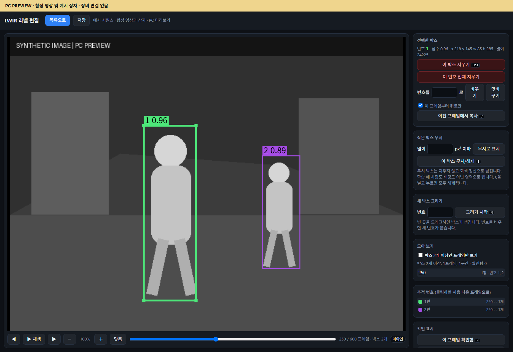

# 라벨 서버 (`label_server/`, 포트 8770)

열화상(LWIR) 녹화에 자동으로 붙인 사람 박스를, 사람이 브라우저에서 고치는 사이트다. 팀원은 받은 주소 하나만 열면 된다.

- 첫 화면은 시퀀스(녹화 한 편) 목록이다. 프레임 수, 확인한 프레임, 삭제한 프레임, 검수 상태, 마지막 저장, 지금 열어 둔 사람이 보인다.
- 시퀀스를 고르면 편집 화면이 열린다. 박스를 지우고, 옮기고, 새로 그리고, 번호를 바꾸고, 쓸모없는 프레임을 삭제 표시한다.
- 저장하면 그 시퀀스 폴더에 `tracks_edited_mot.txt`(고친 라벨)와 `review_state.json`(검수 상태)이 생긴다. 원래 라벨 `tracks_mot.txt`는 바꾸지 않는다.
- 덮어쓰기 전의 파일은 매번 백업한다. 서버는 아무것도 지우지 않는다. 화면의 "삭제"는 휴지통 폴더로 옮기는 것이다.
- 한 시퀀스는 한 사람만 작업한다. 다른 사람이 먼저 저장했으면 덮어쓸지 묻고, 다른 사람이 열어 둔 시퀀스는 이름 바꾸기와 휴지통 보내기를 막는다.

서버는 파이썬 3.10 이상에서 표준 라이브러리만으로 돈다. `src/auto_add_measure.py`만 numpy와 OpenCV(cv2)가 필요하다.

실제 녹화와 라벨은 이 저장소에 없다. 여기에는 프로그램과 안내만 있다.

*8770 편집 화면의 PC 미리보기. 영상, 박스, ID는 합성 예시입니다.*

팀이 전달한 주소를 열고 시퀀스를 고른 뒤 박스와 ID를 수정합니다. 검수한 프레임은 **이 프레임 확인함**으로 표시하고 상단 **저장**을 누릅니다. 저장된 라벨은 [8090 추적 서버의 녹화 재생](../tracking_server/README.md#9-웹-화면)에서 정답 비교에 쓰입니다.

## 무엇이 어디에 있나

    label_server/
      README.md                   이 글
      start_label_server.py       서버를 켜는 파일
      src/                        서버의 부품 (파이썬 패키지 "src")
      page/                       편집 화면
      scripts/                    보드에서 켜 두는 스크립트와 설정 예시, 라벨할 장 고르기 도구(pick_frames.py)
      access_key.example.txt      접속 키 파일의 예시
      .gitignore                  서버가 만드는 파일을 저장소에 올리지 않게 하는 목록
      사용법.txt, 팀원_동기화_안내.txt   서버 없이 편집 화면만 열어 쓰는 법

파일마다 하는 일:

- **`start_label_server.py`** — 서버를 켜는 파일. 옵션을 읽고, 라벨 폴더를 훑고, 접속 키를 준비하고, 서버를 띄운다
- **`src/state.py`** — 여러 부품이 함께 쓰는 고정값과, 서버가 켜져 있는 동안의 기억 (시퀀스 목록, 열어 둔 사람, 잠금)
- **`src/sequences.py`** — 라벨 폴더에서 시퀀스를 찾고, 한 시퀀스의 진행 상태를 읽는다
- **`src/list_page.py`** — 첫 화면(시퀀스 목록)의 글
- **`src/editor_page.py`** — 편집 화면. `label_editor.html`에 "서버로 저장" 기능을 끼워 넣는다
- **`src/file_ops.py`** — 파일을 바꾸는 일: 저장, 삭제한 프레임의 영상 파일 치우기, 시퀀스를 휴지통으로 보내기, 이름 바꾸기
- **`src/handler.py`** — HTTP 요청을 받아 주소별로 나눠 주는 부분, 접속 키 확인
- **`src/auto_add.py`** — 30초마다 `auto_add_measure.py`를 돌리는 배경 작업
- **`src/auto_add_measure.py`** — 따로 도는 프로그램. 실시간 화면의 측정 버튼으로 찍은 녹화(`MEASURE_*` 폴더)를 시퀀스로 바꿔 라벨 폴더에 넣는다
- **`page/label_editor.html`** — 편집 화면. 서버 없이 브라우저로 바로 열어도 쓸 수 있다
- **`scripts/label_keepalive.sh`** — 보드에서 사이트를 켜 두는 스크립트 (cron이 1분마다 실행)
- **`scripts/label_server.env.example`** — 보드마다 다른 값(라벨 폴더, 주소, 포트)을 적는 파일의 예시
- **`access_key.example.txt`** — 접속 키 파일의 예시
- **`사용법.txt`, `팀원_동기화_안내.txt`** — 서버 없이 `label_editor.html`을 직접 열어 쓰는 법 (원드라이브로 폴더를 나눠 쓸 때)

이 글에서 "서버 폴더"는 `start_label_server.py`가 있는 폴더, "라벨 폴더"는 시퀀스 폴더들이 있는 폴더다.

## 켜는 법

1. 라벨 폴더를 준비한다 (아래 "라벨 폴더 모양").
2. 서버 폴더에서 실행한다.

       python3 start_label_server.py --root <라벨 폴더> --bind <주소> --port 8770

3. 켜지면 두 줄을 찍는다. 둘째 줄의 주소를 통째로 팀원에게 준다.

       sequences: 12  frames: 3456
       address: http://<주소>:8770/?k=<접속 키>

옵션:

- **`--root`** — 라벨 폴더. 주지 않으면 환경 변수 `LWIR_LABEL_ROOT`, 그것도 없으면 지금 폴더의 `LWIR_labels`
- **`--bind`** — 서버가 붙을 주소. 주지 않으면 `127.0.0.1` (이 컴퓨터 안에서만 열린다)
- **`--port`** — 포트. 주지 않으면 8770
- **`--only`** — 경로가 이 글로 시작하는 시퀀스만 보여 준다 (예: `opi_sequences`)
- **`--no-token`** — 접속 키 없이 연다

사이트는 암호화하지 않은 http이고 접속 키 하나로만 막는다. 인터넷에 바로 열지 말고, 팀만 닿는 주소(사설 VPN 등)에 붙인다.

편집 화면 파일은 이렇게 고른다.

- 라벨 폴더 바로 아래에 `label_editor.html`이 있으면 그 파일을 쓴다. 우리 보드는 지금 이렇게 돈다.
- 라벨 폴더는 있는데 그 파일이 없으면 `page/label_editor.html`을 쓴다. 그래서 저장소를 받은 그대로 켤 수 있다.
- 두 곳에 모두 있으면 라벨 폴더의 것이 먼저다. `page/`의 것을 고쳐도 라벨 폴더에 옛 파일이 남아 있으면 화면이 바뀌지 않는다.
- 라벨 폴더가 아예 없으면 서버가 켜지지 않는다.

`start_label_server.py`나 `src/` 안의 파일을 고쳤으면 서버를 껐다 켠다. `label_editor.html`만 고쳤으면 브라우저에서 새로 고치면 된다.

### 보드에서 계속 켜 두기 (`scripts/label_keepalive.sh`)

손으로 켤 때는 로그가 남게 이렇게 켠다.

    cd <서버 폴더>
    setsid nohup python3 start_label_server.py --root <라벨 폴더> --bind <보드 주소> --port 8770 >> server.log 2>&1 < /dev/null &

cron이 1분마다 `scripts/label_keepalive.sh`를 돌리게 해 두면, 스크립트가 포트에서 듣는 것이 없을 때만 위 명령을 대신 실행한다. 재부팅 뒤에도 1분 안에 다시 켜진다.

    crontab -e
    * * * * * bash <서버 폴더>/scripts/label_keepalive.sh >> <서버 폴더>/keepalive.log 2>&1

스크립트에는 주소도 폴더도 적혀 있지 않다. 아래 값을 쓴다. 각 항목: 값 — 적지 않았을 때, 바꾸는 이름.

- **서버 폴더** — 적지 않았을 때: 스크립트가 있는 `scripts/`의 바로 위. 바꾸는 이름: (없음)
- **라벨 폴더** — 적지 않았을 때: 서버 폴더 옆의 `LWIR_labels`. 바꾸는 이름: `LWIR_LABEL_ROOT`
- **주소** — 적지 않았을 때: 보드의 Tailscale 주소 (`tailscale0`에서 읽는다). 바꾸는 이름: `LWIR_LABEL_BIND`
- **포트** — 적지 않았을 때: 8770. 바꾸는 이름: `LWIR_LABEL_PORT`

바꿀 값은 `scripts/label_server.env`에 적는다. `scripts/label_server.env.example`을 같은 폴더에 그 이름으로 복사해 고친다. 이 파일은 스크립트만 읽는다. 손으로 켤 때는 옵션으로 준다.

스크립트가 켜지 않고 그냥 끝나는 경우:

- 서버 폴더에 `start_label_server.py`가 안 보인다 (데이터 디스크가 아직 안 붙었다)
- 서버 폴더에 `KEEP_OFF` 파일이 있다 (일부러 꺼 둠. 파일을 지우면 1분 안에 다시 켜진다)
- 그 포트에서 이미 듣는 것이 있다
- 주소가 아직 안 올라왔다 (재부팅 직후 Tailscale이 뜨기 전)
- 라벨 폴더가 없다 (이때는 `labels folder not found` 한 줄을 남긴다)

### 살아 있는지 보기, 끄기

    ss -ltnp | grep :8770                    # 한 줄이 나오면 켜져 있다. pid=숫자 를 읽는다
    cat /proc/<숫자>/cmdline | tr '\0' ' '   # start_label_server.py 인지 확인
    kill <숫자>

`pkill -f`는 쓰지 않는다 (여럿이 쓰는 보드라 다른 작업이 같이 죽을 수 있다). cron에 걸어 두었으면 끈 뒤 1분 안에 다시 켜진다. 꺼 둔 채로 두려면 먼저 표시 파일을 만든다.

    touch <서버 폴더>/KEEP_OFF     # 꺼 두기
    rm <서버 폴더>/KEEP_OFF        # 다시 자동으로 켜지게

카메라와 NPU를 쓰지 않으므로 추적 서버(`tracking_server/`, 포트 8090)와 상관없이 켜고 끌 수 있다.

## 접속 키

- 서버 폴더의 `access_key.txt` 안의 한 줄이 키다. 이 파일이 없으면 서버가 처음 켜질 때 12자짜리 키를 무작위로 만들어 넣는다. 그래서 보통은 손으로 만들 필요가 없다.
- 키를 직접 정하려면 `access_key.example.txt`를 `access_key.txt`라는 이름으로 복사하고, 안의 글을 자기 키로 바꾼다. 영문, 숫자, `-`, `_`만 쓴다. 예시 파일의 글을 그대로 쓰지 않는다.
- 주소 끝에 `?k=<접속 키>`를 붙여 한 번 열면 브라우저가 30일 동안 기억한다. 그 뒤로는 키 없이 열린다.
- 키가 없거나 틀리면 "접근 키가 필요합니다" 라는 글만 나온다.
- 키를 바꾸려면 `access_key.txt`를 고치고 서버를 껐다 켠다.
- `access_key.txt`가 빈 파일이면 `--no-token`처럼 키 없이 열린다. 빈 파일로 두지 않는다.
- `access_key.txt`는 저장소에 올리지 않는다 (`.gitignore`에 들어 있다). 이 저장소에는 예시 파일만 있다.

## 라벨 폴더 모양

저장소에는 실제 데이터가 없다. 서버는 아래 모양의 폴더를 기대한다.

    <라벨 폴더>/
      label_editor.html          편집 화면 (없어도 된다. 없으면 page/ 의 것을 쓴다)
      <시퀀스 폴더>/              이름은 자유. 라벨 폴더 아래 4단계까지 찾는다 (예: opi_sequences/seq_001)
        images/000001.png        프레임 영상. 여섯 자리 번호, 1부터. 640x480
        images/000002.png
        ...
        tracks_mot.txt           자동으로 만든 후보 라벨. 서버는 읽기만 한다
        tracks_edited_mot.txt    고친 라벨 (저장하면 생긴다)
        review_state.json        검수 상태 (저장하면 생긴다)

- `tracks_mot.txt`와 `images` 폴더가 함께 있고, `images` 안에 `000001.png` 같은 파일이 하나라도 있으면 시퀀스로 본다.
- 프레임 수는 가장 큰 번호다. 가운데 영상 파일이 없어도 번호를 당기지 않는다.
- 시퀀스 폴더 안의 폴더는 더 들어가 찾지 않는다.
- 폴더를 새로 넣으면 서버를 다시 켜지 않아도 반 분쯤 안에 목록에 나타난다 (목록을 읽을 때, 마지막으로 훑은 지 20초가 지났으면 라벨 폴더를 다시 훑는다).
- 라벨 한 줄은 `프레임,번호,x,y,폭,높이,점수,클래스,-1,-1`이다. 프레임은 1부터 세고(`images/000001.png` = 1), 좌표는 640x480 기준이다. 손으로 고친 박스는 점수 1, 클래스 0은 사람, 1은 무시(사람도 배경도 아닌 영역)다.
- `review_state.json`에는 확인한 프레임(`reviewed`), 삭제 표시한 프레임(`removed`), 영상 파일까지 치운 프레임(`purged`), 마지막 저장 시각과 저장한 사람(`saved`, `saved_by`), 전체 확인을 끝낸 사람과 시각(`completed_by`, `completed`)이 들어간다.

## 서버가 만드는 파일

`scripts/label_server.env`만 빼고 모두 서버 폴더(`start_label_server.py`가 있는 곳)에 생긴다. `src/`, `page/` 안에는 아무것도 만들지 않는다. 모두 `.gitignore`에 들어 있다.

- **`access_key.txt`** — 접속 키
- **`backups/<시퀀스>/`** — 저장하거나 영상 파일을 치우기 직전의 `tracks_edited_mot.txt`, `review_state.json`. 이름 앞에 시각과 저장한 사람이 붙는다
- **`backups/save_log.txt`** — 한 일의 기록. 한 줄에 시각, 시퀀스, 이름, 한 일, 접속한 곳
- **`trash/<시퀀스>/<시각>_<이름>/`** — 편집 화면의 "삭제한 프레임의 영상 파일 지우기"로 옮긴 영상
- **`trash/_sequences/<시각>__<시퀀스>/`** — 목록 화면의 "삭제"로 옮긴 시퀀스 폴더 통째 (시퀀스 경로의 `/`는 `__`로 바뀐다)
- **`auto_add.log`** — 자동 추가 기록 (새 시퀀스를 넣었거나 실패했을 때만)
- **`auto_added.json`** — `auto_add_measure.py`가 이미 처리한 측정 목록
- **`server.log`** — 위의 명령이나 `label_keepalive.sh`로 켰을 때의 서버 출력
- **`keepalive.log`** — cron 줄이 남기는 `label_keepalive.sh`의 출력
- **`KEEP_OFF`** — 일부러 꺼 둘 때 손으로 만드는 표시 파일
- **`scripts/label_server.env`** — 보드마다 다른 값 (손으로 만든다)

되돌리는 버튼은 없다. 되돌리려면 `trash/`나 `backups/`의 파일을 손으로 제자리에 옮기고, 목록이 다시 읽히기를 기다린다.

## 자동 추가 (`src/auto_add_measure.py`)

- 서버는 켜져 있는 동안 30초마다 `src/auto_add_measure.py --dst <라벨 폴더> --state <서버 폴더>/auto_added.json`을 따로 띄운다.
- 이 프로그램은 끝난 측정 녹화를 찾아 `rec_<날짜>_<시각>_<제목>` 시퀀스로 바꿔 라벨 폴더에 넣는다. 한 번 처리한 측정은 `auto_added.json`에 적어 두고 다시 넣지 않으므로, 이름을 바꾸거나 휴지통에 보낸 시퀀스가 되살아나지 않는다.
- 측정 녹화를 찾는 폴더(`--src`)의 기본값은 우리 보드의 데이터 디스크 경로로 적혀 있다. 서버는 `--src`를 넘기지 않으므로, 다른 곳에서는 그 폴더가 없어 아무 일도 하지 않는다. 다른 폴더의 측정을 넣으려면 손으로 돌린다.

      python3 src/auto_add_measure.py --src <측정 폴더> --dst <라벨 폴더>

  손으로 돌릴 때도 `--state`를 주지 않으면 서버 폴더의 `auto_added.json`을 쓴다 (서버와 같은 목록).
- 자동 추가를 끄는 옵션은 없다. numpy나 cv2가 없는 컴퓨터에서는 30초마다 실패 기록이 `auto_add.log`에 쌓인다. 사이트는 그대로 돈다.

## 라벨할 장 고르기 (`scripts/pick_frames.py`)

녹화가 많을 때 어느 장부터 라벨할지 목록을 뽑는 도구다. 사진만 보고 고르며, 서버와는 따로 돈다(numpy 와 opencv 필요). 라벨 폴더는 건드리지 않고 목록 파일만 쓴다.

      python3 scripts/pick_frames.py --root <라벨 폴더> --ratio 0.05 --out picks.json                    일정 간격 (기본)
      python3 scripts/pick_frames.py --root <라벨 폴더> --ratio 0.05 --method kmeans --out picks.json    비슷한 장끼리 묶어 묶음마다 한 장

옵션:

- **`--method uniform`** — 녹화를 이어 붙여 일정 간격으로 (기본)
- **`--method kmeans`** — 비슷한 장끼리 N 묶음으로 나눠 묶음마다 대표 한 장
- **`--method kcenter`** — 이미 고른 장들과 가장 다른 장부터 차례로 (Sener & Savarese, ICLR 2018)
- **`--method random`** — 무작위
- **`--budget N` / `--ratio R`** — 뽑을 장 수 / 비율
- **`--keep-uncertain LO:HI`** — 검출 점수가 이 범위인 상자가 있는 장은 따로 더 남김 (`tracks_mot.txt` 를 읽음)
- **`--uncertain-max M`** — 위에서 남기는 장 수의 한도
- **`--cache 파일.npy`** — 사진 특징을 저장해 두어 다시 돌릴 때 빠르게

결과는 `picks.json`(녹화, 프레임, 파일, 고른 이유)과 `picks.txt`(한 줄에 파일 하나)다.

**기본이 일정 간격인 이유 (2026-11-11 비교).** 우리 실외 녹화 15개(8,929장)에서 1·2·5·10 % 를 뽑아 검수 라벨로 채점했다. 미리 정한 기준에서 묶어서 뽑기는 일정 간격보다 낫지 않았다.

5 % (446장)를 뽑았을 때:

- **일정 간격**
  - 사람 포함률 0.881, 장면 칸 포함률 0.792
  - 작은 사람(<32 px) 장 142, 한 녹화에 쏠린 몫 45 %
- **kmeans**
  - 사람 포함률 0.893, 장면 칸 포함률 0.861
  - 작은 사람(<32 px) 장 69, 한 녹화에 쏠린 몫 17 %
- **kcenter**
  - 사람 포함률 0.881, 장면 칸 포함률 0.833
  - 작은 사람(<32 px) 장 40, 한 녹화에 쏠린 몫 8 %

- 묶어서 뽑으면 긴 녹화 하나에 장 수가 쏠리는 것은 줄지만, 작은 사람이 있는 장을 절반만 뽑는다. 사진을 작게 줄인 특징에서는 작은 사람이 있는 장이 서로 비슷해 보이기 때문이다.
- `--keep-uncertain 0.25:0.5` 는 같은 자료에서 8,929장 중 5,713장을 남겼다. 범위를 좁히거나 `--uncertain-max` 를 같이 준다.
- 고른 장으로 학습한 모델이 더 좋은지는 재지 않았다.

## 화면이 쓰는 주소 (고칠 사람을 위해)

각 항목: 주소 — 하는 일. 그 아래는 코드 파일.

- **`GET /`** — 목록 화면
  - 코드 `src/list_page.py`
- **`GET /edit`** — 편집 화면
  - 코드 `src/editor_page.py`
- **`GET /api/list`** — 시퀀스 목록과 진행 상태
  - 코드 `src/sequences.py`
- **`GET /api/meta?seq=&user=`** — 한 시퀀스의 상태. 이름을 보내면 "지금 열어 둔 사람"으로 90초 동안 기억한다
  - 코드 `src/sequences.py`
- **`GET /data/<시퀀스>/...`** — `RESULT.json`(프레임 수), `images/000001.png`, 라벨 파일 세 가지
  - 코드 `src/handler.py`
- **`POST /api/save`** — 저장
  - 코드 `src/file_ops.py`
- **`POST /api/purge`** — 삭제한 프레임의 영상 파일을 휴지통으로
  - 코드 `src/file_ops.py`
- **`POST /api/seq_rename`, `POST /api/seq_trash`** — 시퀀스 이름 바꾸기, 휴지통으로 보내기
  - 코드 `src/file_ops.py`

## 서버 없이 쓰기

`page/label_editor.html`을 Chrome이나 Edge에서 바로 열고 "폴더 열기"로 시퀀스 폴더를 고르면 서버 없이도 고칠 수 있다. `사용법.txt`와 `팀원_동기화_안내.txt`가 그 방법이다. 두 글은 원드라이브로 폴더를 나눠 쓰던 때의 안내를 그대로 둔 것이라, 거기 나오는 폴더 이름은 예시로 본다.

## 보드에서 돌던 파일과 다른 점

보드에서는 서버 폴더 하나에 `label_server.py` 한 파일과 `auto_add_measure.py`, `label_keepalive.sh`가 나란히 있었고, `label_editor.html`은 라벨 폴더에 있었다. 여기서는 위의 폴더 구조로 나눴다. 사이트가 하는 일은 같다.

각 항목: 보드 → 여기, 그리고 달라지는 것.

- **서버를 켜는 파일**
  - 보드: `label_server.py`
  - 여기: `start_label_server.py`
  - 달라지는 것: 켜는 명령의 파일 이름. `--help`에 찍히는 이름
- **서버 코드**
  - 보드: `label_server.py` 한 파일
  - 여기: `start_label_server.py` + `src/` 8개
  - 달라지는 것: 없음. 옮긴 코드는 글자를 바꾸지 않았다
- **`--root`를 주지 않았을 때**
  - 보드: 만든 사람 PC의 폴더
  - 여기: 환경 변수 `LWIR_LABEL_ROOT` 또는 `LWIR_labels`
  - 달라지는 것: 보드에서는 늘 `--root`를 주므로 없음
- **편집 화면 파일**
  - 보드: 라벨 폴더의 것만
  - 여기: 라벨 폴더의 것이 먼저, 없으면 `page/`의 것
  - 달라지는 것: 라벨 폴더에 파일이 있으면 없음. 라벨 폴더는 있는데 파일만 없을 때, 전에는 켜지지 않았고 이제는 `page/`의 것으로 켜진다
- **자동 추가 프로그램**
  - 보드: 서버 폴더의 `auto_add_measure.py`
  - 여기: `src/auto_add_measure.py`
  - 달라지는 것: 없음. 처리한 측정 목록(`auto_added.json`)은 전과 같이 서버 폴더에 둔다. 서버가 그 자리를 `--state`로 넘기고, 프로그램의 기본값도 서버 폴더로 맞췄다 (두 줄 고침)
- **켜 두는 스크립트**
  - 보드: 서버 폴더의 `label_keepalive.sh`. 주소와 폴더가 적혀 있음
  - 여기: `scripts/label_keepalive.sh`. 주소와 폴더는 `scripts/label_server.env`나 환경 변수로
  - 달라지는 것: cron 줄의 경로. 켜는 조건과 띄우는 명령은 시작 파일 이름 말고 같다
- **`label_editor.html`, `사용법.txt`, `팀원_동기화_안내.txt`**
  - 달라지는 것: 보드의 파일과 바이트까지 같다

보드에는 아직 이 구조로 옮기지 않았다. 옮길 때는 지금의 서버 폴더에 이 폴더의 파일을 그대로 두고(`access_key.txt`, `backups/`, `trash/`, `auto_added.json`, `auto_add.log`, `server.log`는 제자리에 둔다), cron 줄의 경로를 `scripts/label_keepalive.sh`로 바꾸고, 주소를 따로 정했으면 `scripts/label_server.env`에 적은 뒤, 옛 서버를 끈다. 옛 `label_server.py`, `auto_add_measure.py`, `label_keepalive.sh`는 새 것이 도는 것을 본 뒤에 치운다.

## 시험한 것 (2026-11-11)

Windows PC에서, 이 시험을 위해 만든 가짜 시퀀스(작은 PNG 몇 장과 라벨 글)로 했다. 보드에서는 돌려 보지 않았다.

각 항목: 무엇을 시험했나 → 결과.

- **같은 요청 비교** — 보드에서 받은 원래 한 파일짜리 서버와 이 폴더의 서버를 이 PC 안(127.0.0.1)에 나란히 켜고 같은 요청을 보내, 상태 코드·헤더·본문과 디스크에 남은 파일을 비교
  - 결과: 파이썬 3.13.0과 3.10.16에서 각각 시나리오 17개, 요청 278개(그 가운데 파일을 바꾸는 요청 55개)가 모두 같음
- **시험이 차이를 잡는지** — 위 시험이 차이를 정말 잡아내는지: 이 폴더 서버의 시험용 복사본에 작은 고장 17가지를 하나씩 일부러 넣어 봄 (파이썬 3.10.16)
  - 결과: 17가지 모두 "다름"으로 잡힘
- **고친 줄** — 폴더 구조를 바꾸면서 고친 줄이 위 목록("보드에서 돌던 파일과 다른 점")에 적은 것뿐인지, 바꾸기 직전의 파일과 견줌
  - 결과: 파일 8개는 자리만 옮겼고 바이트까지 같음. 실행되는 글이 바뀐 곳은 import 6줄, 자동 추가 프로그램의 자리와 넘기는 값, 편집 화면 파일을 고르는 함수, 스크립트의 경로 줄뿐
- **고치지 않은 함수** — 고치지 않은 함수 10개의 번역된 코드가 원래 한 파일짜리 서버와 같은지
  - 결과: 같음 (파이썬 3.10.16에서 그대로 비교)
- **문법** — 모든 `.py`가 파이썬 3.10 문법인지, `bash -n scripts/label_keepalive.sh`
  - 결과: 통과
- **켜 두는 스크립트** — `scripts/label_keepalive.sh`: `ss`, `ip`, `python3`를 가짜 명령으로 바꿔 Git Bash에서 실행
  - 결과: 18가지 상황 모두 기대대로. 원래 파일과 나란히 돌린 7가지는 같은 결정, 같은 명령 (시작 파일 이름만 다름)
- **자동 추가 프로그램** — `src/auto_add_measure.py`를 가짜 측정 폴더로 직접 실행 (파이썬 3.10.16, numpy 1.26.2, cv2 4.11.0)
  - 결과: 원래 파일과 같은 시퀀스를 만듦. 처리한 측정 목록이 전과 같이 서버 폴더에 생김
- **키 파일과 무시 목록** — 접속 키 파일이 없는지, `.gitignore`가 서버가 만드는 파일을 모두 가리는지 (git을 부르지 않고 규칙을 읽어서 판단)
  - 결과: `access_key.txt` 없음. 13가지 모두 가려짐
- **남은 개인 정보** — 주소, 계정, 홈 경로, PC 경로, 키, 메일 주소가 이 폴더에 남아 있는지
  - 결과: 0곳

"같다"고 볼 때 맞춰 준 것: 시각, 파일 수정 시각으로 만든 버전 값, 시험 폴더 이름, 포트, 시험용 키. 이번에 일부러 바꾼 두 가지(도움말에 찍히는 시작 파일 이름, 오류 글 안의 자동 추가 프로그램 경로)도 맞춰서 비교했다.

비교한 요청에는 화면이 쓰는 모든 주소, 틀린 키, 이름 없는 요청, 틀린 형식, 다른 사람이 먼저 저장한 경우, 다른 사람이 열어 둔 경우(90초 뒤에 풀리는 것까지), 폴더를 새로 넣었을 때 다시 훑는 것, 접속 키 파일이 없을 때·비었을 때, 켜질 때의 실패, 편집 화면 파일이 라벨 폴더에 있을 때·`page/`에만 있을 때·둘 다 없을 때가 들어 있다.

하지 않은 것:

- 보드(리눅스)에서 켜 보는 것, cron에 걸어 보는 것, 보드에 깔린 numpy·cv2로 자동 추가를 돌려 보는 것
- 실제 브라우저에서 화면을 눌러 보는 것 (화면의 글이 원래와 바이트까지 같다는 것만 확인)
- 여러 사람이 정확히 같은 순간에 저장하는 경우
- 서버가 실제 측정 폴더에서 새 시퀀스를 자동으로 넣는 전체 흐름 (서버 쪽은 가짜 프로그램으로 연결과 넘기는 값만, 프로그램은 따로 돌려서 확인)
- git으로 하는 확인 (무시 규칙이 실제로 듣는지, 스크립트의 실행 권한 표시). cron 줄은 `bash <경로>`로 부르므로 실행 권한이 없어도 돈다
