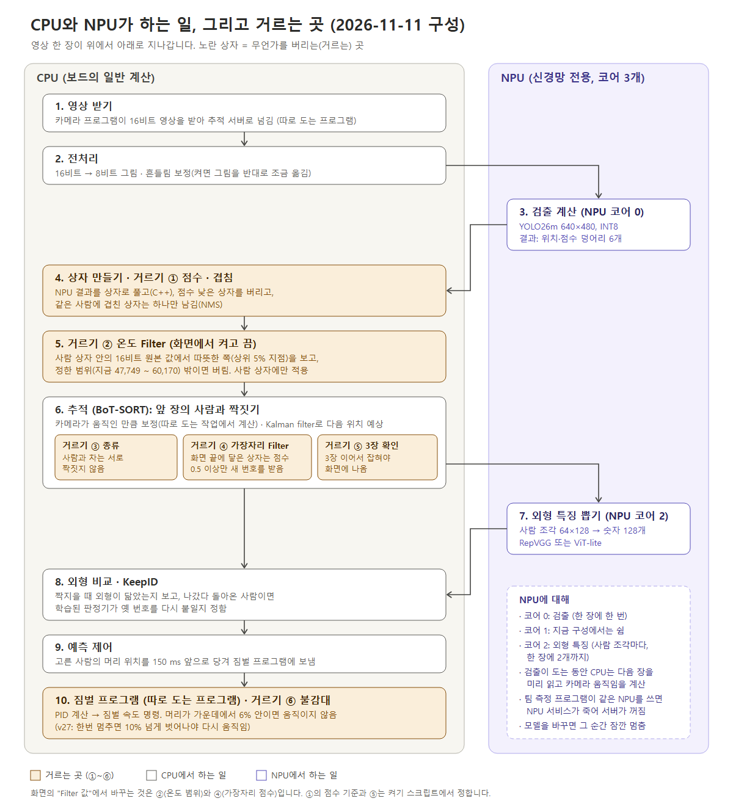

# 실시간 추적 서버 (`tracking_server/`, 포트 8090)

열화상 카메라(640×480) 영상에서 **사람을 찾고, 같은 사람에게 같은 번호를 유지**해 웹 화면으로 보여 주는 서버입니다. 짐벌과 팀 PC GUI 도 여기서 연결합니다. 장치는 DX-M1(Orange Pi 5 Plus)입니다.

2026-11-11 에 폴더 배치를 바꿨습니다. 옛 경로는 [저장소 첫 글의 "옮긴 경로" 표](../README.md#옮긴-경로-2026-11-11)에서 찾을 수 있습니다.

## 전체 흐름 (2026-11-11 구성)


위 그림에서 검출을 NPU 코어 0·1에 번갈아 넣는 방식은 2026-11-11 에 만들어 시험 중인 방식입니다(기본은 코어 0 하나). 숫자는 코어 하나로 돌릴 때 장치에서 읽은 값이고, 가운데 막대의 길이는 이해를 돕기 위한 그림입니다. 사진의 상자와 번호는 검수한 라벨로 그린 예시입니다.


영상 한 장이 위에서 아래로 지나갑니다. 점선 안이 추적 서버 프로그램 하나이고, 상자마다 이 폴더의 어느 곳인지 적혀 있습니다.



| 어디서 | 하는 일 |
|---|---|
| NPU 코어 0 | 검출 계산 (한 장짜리 검출 모델). 한 장에 한 번 |
| NPU 코어 1 | 지금 구성에서는 쉼 |
| NPU 코어 2 | 외형 특징 뽑기 (사람 조각마다, 한 장에 2개까지) |
| CPU | 영상 받기, 전처리, 상자 만들기, 거르기, 추적, 외형 비교 판정, 예측 제어, 웹 처리, 짐벌 PID |

거르는 곳 (순서대로)

| 번호 | 이름 | 무엇을 버리나 | 어디서 바꾸나 |
|---|---|---|---|
| ① | 점수 · 겹침 | 점수 낮은 상자, 같은 사람에 겹친 상자 | `scripts/run_real_gui.sh` |
| ② | 온도 Filter | 사람 상자 안의 16비트 원본 값(상위 5% 지점)이 정한 범위 밖인 것 | 화면 "Filter 값" |
| ③ | 종류 | 사람과 차를 서로 짝짓는 것 | `scripts/run_real_gui.sh` |
| ④ | 가장자리 Filter | 화면 끝에 닿은 상자 중 점수가 낮은 것은 새 번호를 받지 못함 | 화면 "Filter 값" |
| ⑤ | 3장 확인 | 3장 이어서 잡히지 않은 것은 화면에 나오지 않음 | `scripts/run_real_gui.sh` |
| ⑥ | 불감대 | 조준점이 가운데 가까이 있으면 짐벌이 움직이지 않음 | `scripts/run_real_gui.sh`, `scripts/live.env` |

장치에서 읽은 값 (2026-11-11, 짧게 한 번씩 본 값): 장 사이 약 45 ms (초당 22~24장), 한 장 계산 합계 약 58 ms, 영상 도착부터 결과까지 중간값 약 75 ms. 단계별 시간은 아직 재지 않았습니다.

## 1. 무엇이 어디에 있나

```
tracking_server/
├── README.md                  이 글
├── start_tracking_server.py   서버를 켜는 파일 (옵션을 받아 src/app.py 의 main 을 부름)
├── models/                    모델 파일 (detect / track / reid) 과 확인값 MANIFEST.json
├── src/                       서버 코드, 일별 폴더
│   ├── app.py                 본체: 옵션 → 준비 → 프레임 반복 → 결과 저장
│   ├── detect/                검출
│   ├── track/                 추적
│   ├── reid/                  외형 비교(re-ID)
│   ├── camera/                카메라
│   ├── gimbal/                짐벌과 PC GUI
│   ├── web/                   웹 화면 요청 처리
│   └── common/                함께 쓰는 값
├── page/                      웹 화면 한 파일과 그 조각, 만들기 도구
├── scripts/                   장치 준비, 켜기, 꺼지면 다시 켜기
└── images/                    그림 (pipeline_20261111, cpu_npu_filters_20261111 = 지금 구성. 나머지 넷은 2026-11-06 까지의 구성)
```

| 폴더 | 하는 일 | 안의 파일 |
| --- | --- | --- |
| [`models/`](models/) | 모델 파일. 표와 측정값은 [models/README.md](models/README.md) | `detect/` 검출, `track/` 판정기·위치 기억, `reid/` 외형 비교, `MANIFEST.json` |
| [`src/detect/`](src/detect/) | 프레임 한 장을 사람·차 상자로 만듦 | `npu_engine.py` NPU 에 모델 올리기·돌리기, `detect_frame.py` 프레임 → 상자, `model_scan.py` 검출 모델 파일 스스로 찾기, `zoom_redetect.py` 작은 사람 확대 재검출, `native_post.py` + `post.cpp` 검출기 출력을 푸는 빠른 계산 |
| [`src/track/`](src/track/) | 상자에 번호를 붙이고 유지 | `trackers.py` 추적기들, `kalman.py` Kalman filter, `camera_motion.py` 카메라 움직임 추정, `position_memory.py` 놓친 사람 위치 기억, `gate.py` 확인 판정기, `stitch.py` 끊긴 추적 잇기, `stabilizer.py` 화면 흔들림 보정 |
| [`src/reid/`](src/reid/) | 사람 외형을 비교해 원래 번호를 돌려줌 | `reid_models.py` 외형 모델 목록과 실행 중 바꾸기, `reid_embed.py` 사람 조각에서 특징 뽑기, `relabel_online.py` KeepID 규칙, `relink_online_judge.py` 번호 잇기 판정기 |
| [`src/camera/`](src/camera/) | 카메라에서 프레임을 받음 | `cam_pipe.cpp` 카메라 프로그램, `camera_link.py` 그 프로그램을 띄우고 읽기·카메라 초기화 |
| [`src/gimbal/`](src/gimbal/) | 짐벌을 움직이고 PC GUI 와 주고받음 | `gimbal_bridge_v25.cpp` 짐벌 + PC GUI 프로그램, `team/` 팀 제어·GUI 코드 사본(출처 `team/SOURCE.txt`), `gimbal_link.py` 그 프로그램을 띄우고 명령 보내기, `test_*.py` 시험, `PID_TUNING_RECORD_20261110.md` 제어값 기록 |
| [`src/web/`](src/web/) | 웹 화면의 요청에 답함 | `page_handler.py` 주소별 처리, `page_settings.py` 화면에서 바꾸는 설정·모델 바꾸기, `measure.py` 측정 버튼, `system_buttons.py` 재부팅 버튼 |
| [`src/common/`](src/common/) | 여러 부분이 함께 쓰는 것 | `shared_values.py` 고정 값, `state.py` 공유 값 보관함, `settings.py` 실행 중 바뀌는 설정, `result_summary.py` 결과 요약, `device_wait.py` 다른 측정 기다리기, `pc_dry_run.py`·`research_prepare.py`·`research_synth.py` PC 에서 돌려 보기와 연구용 기능 |
| [`page/`](page/) | 웹 화면 | `live_page.html` 서버가 읽는 한 파일, `html/` `css/` `js/` 그 조각, `build_page.py` 조각을 이어 붙이는 도구, `parts.json` 조각 순서 |
| [`scripts/`](scripts/) | 장치에서 돌리는 스크립트 | `setup.sh` 준비, `run_real_gui.sh` 켜기, `keepalive.sh` 꺼지면 다시 켜기, `live.env.example` 장치별 설정 예, `gui_model_client.py` PC GUI 명령 시험 |

`src/CHANGES_FROM_RESEARCH_SCRIPT.md` 는 연구용 스크립트와의 차이를 적은 옛 기록입니다.

## 2. 준비물

옛 배치에서 확인한 환경입니다. 새 배치로는 장치에서 다시 확인하지 않았습니다(7절).

- DX-M1(Orange Pi 5 Plus), DXRT 3.4.2, Ubuntu 22.04, Python 3.10, g++ 11.4.
- Python 패키지: numpy, opencv(cv2), scipy, `dx_engine`.
- NPU 가 비어 있어야 합니다.
- i3system 열화상 카메라와 카메라 SDK(`/usr/local/include/i3system`). 없으면 `cam_pipe` 를 빌드하지 않습니다.
- 짐벌(시리얼, 기본 `/dev/ttyUSB0`), OpenCV(`opencv4`)와 GStreamer(`gstreamer-1.0`, `gstreamer-app-1.0`). 없으면 짐벌 프로그램을 빌드하지 않고, 켜기 스크립트가 시작하지 않습니다.
- 웹 화면 주소. 기본은 장치의 Tailscale 주소(`tailscale0`)입니다.
- `fuser`, `pgrep`, `curl`, `flock`, cron.

## 3. 준비와 켜기

### 3-1. 준비 (한 번): `scripts/setup.sh`

```bash
git clone https://github.com/lwir-deepx-tracking-system/model-bank.git
bash model-bank/tracking_server/scripts/setup.sh
```

어느 폴더에서 불러도 됩니다. 스크립트가 하는 일:

1. `src/detect/post.cpp` → `src/detect/post.so` 빌드.
2. `models/links/<내부 이름>.dxnn` 링크 만들기(`models/MANIFEST.json` 의 `_links` 표대로, 9개).
3. 확인값(sha256)으로 모델 파일 확인: 내부 이름 9개와 DXNN 18개. 없거나 다른 파일이 있으면 그 이름을 알려 주고 멈춥니다.
4. 카메라 SDK 가 있으면 `src/camera/cam_pipe.cpp` → `src/camera/cam_pipe` 빌드.
5. OpenCV 와 GStreamer 가 있으면 `src/gimbal/gimbal_bridge_v25.cpp` + `src/gimbal/team/` → `src/gimbal/gimbal_bridge_v25` 빌드.

끝에 `model files checked: 18 of 18 OK` 와 `setup done` 이 나오면 됩니다. 빌드한 파일과 `models/links/` 는 git 에 올라가지 않습니다(`.gitignore`).

### 3-2. 켜기: `scripts/run_real_gui.sh`

```bash
bash model-bank/tracking_server/scripts/run_real_gui.sh
```

브라우저에서 `http://<페이지 주소>:8090/` 을 엽니다. **화면에는 비밀번호가 없고 짐벌을 움직입니다.** 믿을 수 있는 기기만 닿는 주소를 쓰세요.

- 실행 폴더는 `tracking_server/` 입니다. 메시지는 `real_gui_1.out`, 결과는 `real_gui_1/` 에 남습니다. **손으로 켜면 이전 `real_gui_1/` 을 지웁니다.**
- 시작 구성: 검출 `--det w480`(YOLO26m_(FLIR) 640x480), 외형 모델 `RVGGA0_REID2C256`(RepVGG_distillation_(TMOT,CAMEL)_20261103), 번호 잇기 판정기 `models/track/relink_judge_frozen.json`, 카메라 움직임 보정 켬, 온기 기준 `--warm-min 45000`(우리 카메라에서 잰 값), `--live-seconds 604800`(7일 뒤 스스로 끝남).
- 스크립트는 확인 판정기(`--confirm-gate models/track/gate_gru32_frozen.json`)도 넘기지만, 실시간에서는 화면에서 고른 추적기가 쓰이고 그 판정기는 쓰이지 않습니다(코드 `src/app.py`).
- 짐벌: PD 제어(Kp 30 기본, Ki 0, Kd 6, 불감대 0.06), 방향키 속도 20, 자동으로 따라갈 때 최고 속도 100, 놓친 사람을 기다리는 시간 10초. 제어값은 최고 속도 10 일 때 맞춘 것입니다(`src/gimbal/PID_TUNING_RECORD_20261110.md`).
- 서버는 마지막으로 고른 검출 모델 등을 `last_selection.json` 에 적어 두고 다음에 켤 때 되살립니다.

장치마다 다른 값은 `scripts/live.env.example` 을 `scripts/live.env` 로 복사해 고칩니다.

| 값 | 뜻 | 기본 |
| --- | --- | --- |
| `LWIR_LIVE_BIND` | 웹 화면 주소 | 장치의 Tailscale 주소 |
| `LWIR_LIVE_PORT` | 웹 화면 포트 | 8090 |
| `LWIR_GUI_HOST` | 팀 PC GUI 주소 | 192.168.50.1 |
| `LWIR_GIMBAL_DEV` | 짐벌 시리얼 장치 | `/dev/ttyUSB0` |
| `LWIR_GIMBAL_SPEED_MAX` | 자동으로 따라갈 때의 최고 속도 | 100 |
| `LWIR_GIMBAL_REACQUIRE_MS` | 놓친 사람을 기다리는 시간(ms) | 10000 |

바로 끝나면 `real_gui_1.out` 과 끝나는 값을 봅니다.

| 끝나는 값 | 뜻 |
| --- | --- |
| 4 | 서버가 이미 떠 있음 (옛 이름 `lwir_tracker_m1.py` 로 뜬 것도 포함) |
| 5 | 짐벌 장치를 다른 프로그램이 씀 |
| 7 | `src/gimbal/gimbal_bridge_v25` 없음 (`scripts/setup.sh` 다시) |
| 8 | 페이지 주소 없음 (`scripts/live.env` 에 `LWIR_LIVE_BIND`) |
| 9 | 폴더 이동 실패 |

### 3-3. 꺼지면 다시 켜기: `scripts/keepalive.sh`

crontab 에 한 줄을 넣습니다(`<클론 경로>` 는 저장소를 받은 곳).

```
* * * * * flock -n $HOME/.lwir_keepalive.lock bash <클론 경로>/tracking_server/scripts/keepalive.sh >> $HOME/lwir_keepalive.log 2>&1
```

- 5초마다 `/healthz` 를 읽습니다. 서버 프로세스가 없거나, 30초 동안 답이 없거나, 프레임은 오는데 30초 동안 결과가 안 나오거나, 짐벌 프로그램이 3번 연속 없으면 서버를 다시 켭니다. 시작 뒤 180초 동안은 멈춤 검사를 하지 않습니다.
- 다시 켤 때는 이전 `real_gui_1/` 을 `real_gui_prev/` 로 옮겨 둡니다.
- 10분에 3번 다시 켜면 10분 쉽니다.
- 기록은 `~/lwir_keepalive.log`, 꺼질 때의 마지막 메시지는 `~/lwir_crash.log` 입니다.
- **잠시 멈추기**: `touch ~/lwir_keepalive.pause`. 다시 돌리기: `rm ~/lwir_keepalive.pause`.
- 장치 재부팅 단계는 `~/lwir_keepalive.allow_reboot` 파일이 있을 때만 켜집니다(카메라 프로그램이 3번 연속 실패, 15분 동안 프레임 없음, 켜진 지 30분 넘음, 하루 2번까지, 60분 간격). 파일이 없으면 재부팅하지 않습니다.
- 카메라는 건드리지 않습니다. 카메라가 멈추면 `cam_pipe` 가 스스로 다시 엽니다.
- **옮기는 날 주의**: 이 스크립트는 옛 이름(`lwir_tracker_m1.py`)으로 떠 있는 서버를 찾지도 멈추지도 않습니다. 옛 keepalive 와 옛 서버를 먼저 멈춘 뒤 cron 에 겁니다.

### 3-4. 끄기

```bash
touch ~/lwir_keepalive.pause
kill -TERM $(pgrep -f 'python3 -B [s]tart_tracking_server.py')
```

`cam_pipe` 는 서버가 끝나면 스스로 끝납니다. `cam_pipe` 를 `kill -9` 로 끄지 마세요(카메라가 다음에 안 열릴 수 있습니다).

### 3-5. 파일 실행 (실시간이 아닌 방식)

`--live-port` 를 주지 않으면 저장된 프레임 폴더를 추적해 결과 파일(`TRACKS.jsonl`, `RESULT.json`)로 남깁니다. `--data` 에 `coco.json` 이 든 프레임 폴더를 줍니다. 옵션 설명은 `python3 start_tracking_server.py --help` 로 봅니다. 옛 글의 명령은 없앤 타일 모델(`--det rt480`)을 쓰는 것이라 옮기지 않았고, 이 배치에서 파일 실행을 장치로 돌려 본 적은 없습니다.

## 4. 웹 화면과 주소

화면은 위에서부터 맨 위 줄(제목, 상태 점) → 영상과 속도·지연 그래프 → 상태 칸 → Filter 값 → 짐벌 제어기 → 설정(검출 모델, 추적기, 외형 모델, 위치 기억) → System → 측정 → 단축키입니다. 화면이 400 ms 마다 살아 있다는 신호(`/gimbal/ping`)를 보냅니다.

읽기 (GET):

| 주소 | 주는 것 |
| --- | --- |
| `/` | 웹 화면 (`page/live_page.html`. 열 때마다 파일을 다시 읽음) |
| `/stream` | 상자와 번호를 그린 영상 (MJPEG) |
| `/snap.jpg` | 지금 그림 한 장 |
| `/healthz` | 살아 있는지: `up`, `cam_idle`, `out_idle`, `cam_fail`, `cam_pipe_alive`, `gimbal_alive`, `rss_mb`, 지연 값 등 |
| `/model` | 검출 모델 목록과 지금 쓰는 모델, 바꾸기 기록 |
| `/rules` | 추적기 종류, Filter 값, 외형 모델 목록, 위치 기억 목록 등 지금 설정 |
| `/perf` | 그래프용 초당 기록 (추적 fps, 카메라 fps, 지연, 계산 시간) |
| `/measure`, `/measure/<번호>` | 측정 상태, 지난 측정 하나 |
| `/gimbal/people` | 짐벌 상태와 지금 화면의 사람 상자 |

바꾸기 (POST, 머리말 `X-Gimbal: 1` 이 있어야 함):

| 주소 | 하는 일 |
| --- | --- |
| `/model/set?id=<번호>` | 검출 모델 바꾸기 |
| `/rules/set?...` | 추적기 종류, Filter 값, 외형 모델, 위치 기억 등 바꾸기 |
| `/measure/start`, `/measure/stop`, `/measure/note` | 측정 시작, 끝, 메모 |
| `/camera/reset` | 카메라 초기화 버튼 |
| `/system/reboot?confirm=REBOOT` | 장치 재부팅 버튼 |
| `/gimbal/click`, `/gimbal/move`, `/gimbal/stop` | 사람 고르기, 손으로 움직이기, 멈추기 (짐벌이 연결돼 있을 때만) |
| `/gimbal/ping` | 화면이 살아 있다는 안전 신호. **스크립트에서 보내지 마세요** |

측정은 `<측정 폴더>/<날짜>/MEASURE_<시각>_<번호>[_<이름>]/` 에 남습니다. 영상 저장을 켜면 16비트 원본 `frames.raw.gz` 와 `frames.json` 이 함께 남습니다. 측정 폴더 기본값은 `/mnt/lwir_data/results/live_measure`(`--measure-dir`)입니다.

팀 PC GUI 와는 짐벌 프로그램이 통신합니다: 영상 H.264/RTP → UDP 5000, 추적 상자 → UDP 5001, PC 의 명령 ← TCP 5002. PC GUI 없이 명령을 시험하려면 `python3 scripts/gui_model_client.py <주소> <포트> count|tcount|change:<번호>|wait:<초>` 를 씁니다.

## 5. 웹 화면을 고치는 법

서버는 `page/live_page.html` 한 파일만 읽습니다. 그 파일은 손으로 고치지 않고, 조각을 고친 뒤 다시 만듭니다.

1. `page/html/`, `page/css/`, `page/js/` 에서 고칠 조각을 찾아 고칩니다(어느 조각에 무엇이 있는지는 [page/README.md](page/README.md)의 표).
2. `page/` 폴더에서 `python3 build_page.py` 로 `live_page.html` 을 다시 만듭니다.
3. `python3 build_page.py --check` 가 같다고 답하는지 봅니다.
4. 고친 조각과 다시 만든 `live_page.html` 을 함께 올립니다.

서버를 다시 켤 필요는 없습니다. 브라우저에서 새로 고치면 바뀐 화면이 나옵니다.

## 6. 모델과 서버가 모델을 찾는 법

모델 표는 [models/README.md](models/README.md)에 있습니다. 요약:

- 내부 이름이 있는 모델(검출 4개, 외형 5개)은 `scripts/setup.sh` 가 만든 `models/links/<내부 이름>.dxnn` 링크로 찾고, `models/MANIFEST.json` 의 확인값과 대조합니다.
- 그 밖의 검출 모델은 서버가 `models/detect/` 와 그 바로 아래 폴더에서 스스로 찾아 화면 목록에 "(자동 등록)"으로 올립니다. 입력이 640×480 또는 640×640 이고 출력이 분할 출력 6개이거나 `[1,300,6]` 하나인 파일만 올립니다. 다른 폴더를 보게 하려면 `--bank-dir`, 끄려면 `--no-bank-auto`.
- 검출 모델과 외형 모델은 서버를 켠 채로 화면에서 바꿉니다.
- 위치 기억(GRU, Mamba) 가중치는 `models/track/pos_gru.npz`, `pos_mamba.npz` 에서 읽습니다. 지금 들어 있는 것은 1 epoch 시험용이라 **쓰지 마세요.**

## 7. 한계와 확인 범위

### 새 폴더 배치 (2026-11-11) 에서 확인한 것: PC 에서만, 가짜 장치로

- 나누기 전 한 파일짜리 서버와 같은 동작인지 PC 에서 비교했습니다: 파일 실행 12가지 결과가 같음, 가짜 카메라·짐벌·웹으로 돌린 실시간 방식에서 요청 92개의 답이 같음, `page/build_page.py --check` 통과, 스크립트 문법 확인 통과(옮긴 작업의 기록).
- **장치에서는 아무것도 돌려 보지 않았습니다.** `scripts/setup.sh` 의 빌드, 링크 만들기와 확인, `scripts/run_real_gui.sh` 로 켜기, `scripts/keepalive.sh`, 실제 카메라·짐벌·NPU 모두 이 배치로는 확인 전입니다.
- 검출 모델 자동 등록의 순서가 파일 이름 순에서 경로 순으로 바뀌었습니다. 화면 목록의 5번부터 번호가 전과 다를 수 있습니다.

### 옛 배치에서 장치로 확인한 것 (날짜와 조건 그대로)

- 2026-11-06, 파일 실행, FLIR 시험 영상 8편 3,749프레임, 검출 YOLO26m_(FLIR) 640x480, 확인 판정기와 번호 잇기 판정기 켬: 사람 AP50 0.7651, HOTA 0.5541, IDF1 0.6783, 번호 바뀜 39, 틀린 상자 767, 놓침 4,416, 62.5 fps. 한 번 잰 값입니다. 같은 조건에서 번호 잇기 판정기를 끄면 IDF1 0.6852, HOTA 0.5629 로 **끈 쪽이 높았습니다**(번호 바뀜은 켠 쪽이 적음).
- 2026-11-10, 장치의 자체 스크립트 사본으로 실제 카메라·짐벌을 돌림: 서버를 강제로 끄면 8초 안에 다시 켜짐, 멈춤 파일이 있으면 다시 켜지 않음, 두 번째 `cam_pipe` 는 끝나는 값 7 로 거절됨, 장치가 갑자기 다시 시작된 뒤 부팅 44초 만에 서버가 답함. 이 저장소의 `scripts/` 는 그 사본과 조금 다릅니다(폴더와 주소를 스크립트 자리와 `live.env` 에서 읽음).

### 알아 둘 것

- 실제 카메라 영상은 정답이 없어 점수를 재지 않았습니다. 추적 결과를 정답으로 쓰지 마세요.
- 실제 카메라에서 다른 사람이 번호를 이어받는 경우가 보고되었습니다(옛 README 기록).
- 확인 판정기와 번호 잇기 판정기는 고정 카메라 공개 영상(TMOT)으로 학습했습니다. 우리 카메라에서 같은 이득이 난다는 확인은 없습니다.
- 화면의 추적기 중 OC-SORT, BoT-SORT, SORT 는 화면에도 "시험 안 함"으로 나옵니다.
- 다른 프로그램이 NPU 를 쓰거나 NPU 서비스가 다시 시작되면 서버가 멈출 수 있습니다(2026-11-04 에 한 번 관찰).
- 2026-11-10 에 장치 전체가 두 번 응답하지 않았습니다. 원인은 찾지 못했습니다.
- 자동으로 따라갈 때의 최고 속도 100 은 제어값을 맞춘 조건(10)과 다릅니다. 되돌리려면 `scripts/live.env` 에 `LWIR_GIMBAL_SPEED_MAX=10`.
- 8시간 연속 실행과 재부팅 단계는 돌려 본 기록이 없습니다.
- `images/` 의 그림 네 장(`pipeline_m1.png`, `system_structure.png`, `code_structure.png`, `final_summary_m1.png`)은 2026-11-06 까지의 구성(검출 타일 2장, 한 파일짜리 코드의 줄 번호)을 그린 것이라 지금 배치와 다릅니다.

지난 측정표 전체는 git 기록의 옛 README 에 있습니다.

## 짐벌 프로그램과 조준 높이 (scripts/live.env)

| 값 | 기본 | 뜻 |
|---|---|---|
| `LWIR_GIMBAL_BRIDGE` | `src/gimbal/gimbal_bridge_v25` | 짐벌 프로그램. `src/gimbal/gimbal_bridge_v27` 은 움직임을 부드럽게 하려는 시험용 판입니다(`src/gimbal/V27_CHANGES.md` 의 명령으로 먼저 빌드). 실제 짐벌에서 흔들림이 줄어드는지는 아직 재지 않았습니다. |
| `LWIR_GIMBAL_EXTRA_OPTS` | 없음 | 짐벌 프로그램에 더 줄 옵션. v27 예: `--deadband-exit 0.10 --axis-reversal 1` |
| `LWIR_GIMBAL_AIM_Y` | `0.08` | 사람 상자의 어느 높이를 화면 가운데에 둘지(위에서부터의 비율). 0.08 = 머리, 0.3 = 가슴. 화면의 세로 오차 표시 기준(`page/js/04_ping_fps_aim.js` 의 `AIM_Y`)과 같아야 합니다. |
| `LWIR_GIMBAL_DEV` | 고정 이름을 먼저 찾고 없으면 `/dev/ttyUSB0` | 짐벌 직렬 장치 |

화면(8090)은 장치에서 받아 온 것에서 두 군데를 고쳤습니다(2026-11-11): Filter 를 "검출 모델" 다음 줄로 옮겼고, 세로 오차 표시 기준을 머리로 바꿨습니다.
