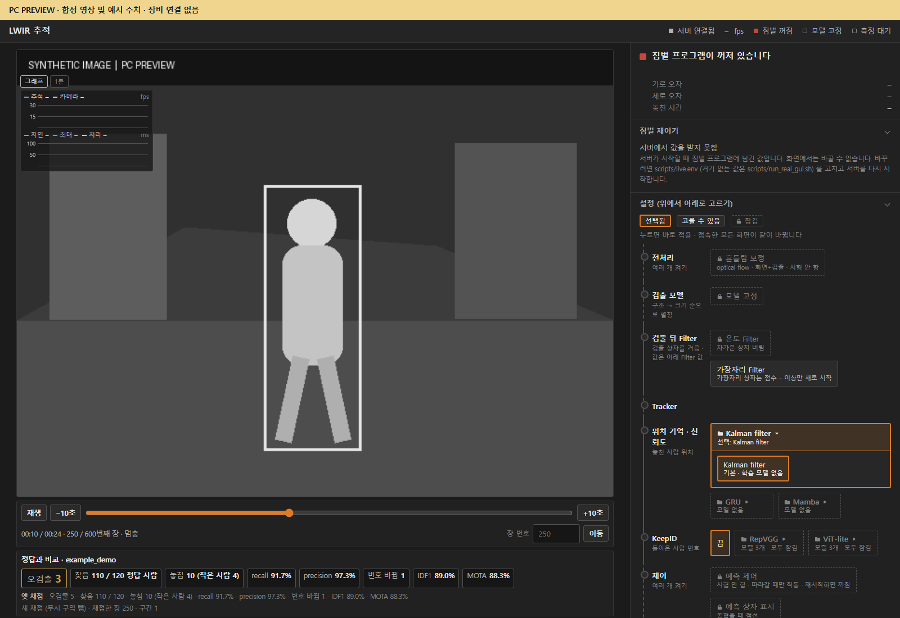
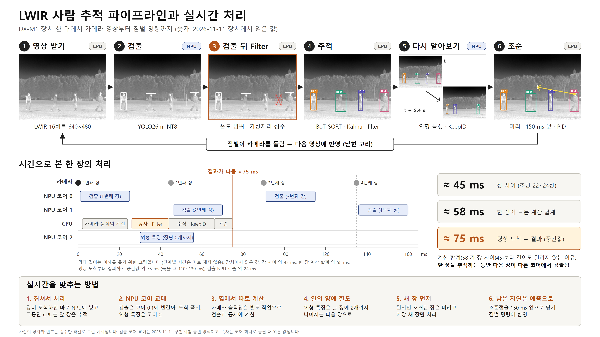

# 실시간 추적 서버 (`tracking_server/`, 포트 8090)

열화상 카메라 영상에서 **사람을 찾고, 같은 사람에게 같은 번호를 유지하고, 고른 사람을 짐벌로 따라가는** 서버입니다. 장치는 DX-M1(Orange Pi 5 Plus) 한 대입니다.

## 웹 인터페이스 빠른 사용법

장치에서 [빠른 시작](#2-빠른-시작)으로 서버를 켠 뒤, 팀 네트워크에서 `http://<장치 주소>:8090/`을 엽니다.



*8090의 녹화 재생 화면을 PC에서 렌더링한 예시입니다. 영상과 채점 수치는 합성입니다.*

| 할 일 | 화면에서 조작하는 순서 |
|---|---|
| 실시간 보기 | 카메라 영상에서 검출 박스와 추적 번호를 확인합니다. 오른쪽 **설정**에서 모델, 추적기, 필터를 확인하거나 바꿉니다. 설정을 바꾸면 접속 중인 화면에 함께 반영됩니다. |
| 녹화 재생 | 오른쪽 **녹화 재생**에서 시퀀스를 고릅니다. 영상 아래에서 재생·일시정지, ±10초, 위치 막대, 프레임 번호 이동을 사용합니다. |
| C++ ByteTrack | [설치·선택 방법](src/track/README.md#c-bytetrack-설치와-비교). 카메라에서는 Tracker → **ByteTrack · C++**, 녹화에서는 재생의 추적기에서 고릅니다. |
| 정답과 비교 | [8770 라벨 서버](../label_server/README.md)에서 검수한 녹화를 재생합니다. 영상 아래에서 오검출·놓침·ID 변경·IDF1·MOTA를 확인합니다. **정답 상자 그리기**를 켜면 정답 박스도 화면에서 확인할 수 있습니다. |
| 지연 측정 | **측정**을 시작하고 끝내면 프레임 처리 지연과 연속 결과의 출력 간격이 각각 기록됩니다. |

| 연결할 클라이언트 | 인터페이스 |
|---|---|
| 브라우저 | HTTP 8090의 `/`에서 화면을 엽니다. `GET /stream`은 MJPEG 영상, `GET /healthz`는 상태, `GET /measure`는 측정 상태를 제공합니다. [HTTP 경로 전체](#9-웹-화면) |
| 팀 PC GUI | H.264/RTP 영상은 UDP 5000, 추적 박스는 UDP 5001, PC 명령은 TCP 5002를 사용합니다. [통신 형식](src/gimbal/team/docs/pc_communication.md) |

## 추적 파이프라인



> 그림 읽는 법: 숫자는 2026-11-11 에 장치에서 짧게 읽은 값이고, 막대 길이는 이해를 돕는 그림입니다(실제 단계별 시간은 7절). 그림의 "코어 0·1 교대"는 시험한 방식입니다. 현재 선택과 실제 두 코어 동작 여부는 System의 교대 투입 표시를 확인합니다. 사진의 상자와 번호는 검수한 라벨로 그린 예시입니다.

## 목차

1. [한눈에 보기](#1-한눈에-보기)
2. [빠른 시작](#2-빠른-시작)
3. [폴더](#3-폴더)
4. [설정](#4-설정-scriptsliveenv)
5. [거르는 곳](#5-거르는-곳)
6. [짐벌이 멈추는 경우](#6-짐벌이-멈추는-경우)
7. [속도: 장치에서 잰 값](#7-속도-장치에서-잰-값)
8. [꺼지면 다시 켜기, 끄기](#8-꺼지면-다시-켜기-끄기)
9. [웹 화면](#9-웹-화면)
10. [모델](#10-모델)
11. [확인한 것과 확인하지 않은 것](#11-확인한-것과-확인하지-않은-것)

## 1. 한눈에 보기

| 단계 | 하는 일 | 어디서 |
|---|---|---|
| 1. 영상 받기 | 16비트 640×480 영상 | CPU |
| 2. 검출 | YOLO26m 으로 사람 상자 | **NPU 코어 0** |
| 3. 검출 뒤 Filter | 온도·가장자리로 상자 거르기 | CPU |
| 4. 추적 | 번호 유지 (BoT-SORT, Kalman) | CPU |
| 5. 다시 알아보기 | 외형으로 옛 번호 (KeepID) | **NPU 코어 2** + CPU |
| 6. 조준 | 머리를 가운데로, PID | CPU |

- 신경망 두 개(검출, 외형)는 모두 `.dxnn`(INT8)으로 DX-M1 NPU 에서 돕니다. CPU 에서 도는 신경망은 없습니다.
- 예측 제어를 켜면 유효한 연속 관측에서 기본 150ms 앞의 이동량을 제어에 보탭니다. 표시 박스는 옮기지 않습니다. 새 v27과 Python을 함께 갱신해야 하며, 성공한 카메라 움직임 보정이 없으면 관측만 사용합니다. [수정 원리와 검증 범위](src/gimbal/V27_CHANGES.md#11-12-관측과-예측을-분리)
- 코드 자리: 1 `src/camera/`, 2 `src/detect/`, 3·4 `src/track/`, 5 `src/reid/`, 6 `src/gimbal/`.

## 2. 빠른 시작

첫 설치는 [처음 설치하고 켜기](../README.md#처음-설치하고-켜기), 기존 설치는 [기존 저장소 업데이트](../README.md#기존-저장소-업데이트)를 참고하세요. 저장소에 들어간 다음 [빌드와 서버 실행](../README.md#빌드와-서버-실행)을 진행합니다.

브라우저에서 `http://<장치 주소>:8090/` 을 엽니다.

- **화면에는 비밀번호가 없고 짐벌을 움직입니다.** 믿을 수 있는 기기만 닿는 주소에서 쓰세요.
- 실시간 카메라와 기본 PC GUI를 실행하려면 `setup.sh`에서 `cam_pipe built`, `gimbal_bridge_v25 built`, 마지막 `setup done`을 확인합니다.
- 장치마다 다른 값은 `scripts/live.env.example` 을 `scripts/live.env` 로 복사해 고칩니다 (4절).
- 서버를 다시 켜면 예측 제어는 꺼진 채로 켜집니다. 화면에서 다시 켭니다.
- v27의 한 프레임 관측 누락 보완은 별도 옵션입니다. 정상 라이브 영상에서 선택한 사람이 잠깐 빠질 때만 기존 이동을 짧게 이어갑니다. 영상 동결·연속 누락에서는 정지합니다. [조건·설정·검증 범위](src/gimbal/V27_CHANGES.md#11-12-정상-영상의-한-프레임-관측-누락)

<details>
<summary>준비물</summary>

- DX-M1(Orange Pi 5 Plus), DXRT 3.4.2, Ubuntu 22.04, Python 3.10, g++
- Python 패키지: numpy, opencv(cv2), scipy, `dx_engine`
- i3system 열화상 카메라와 카메라 SDK(`/usr/local/include/i3system`). 없으면 카메라 프로그램을 빌드하지 않습니다.
- 짐벌(직렬 장치), OpenCV(`opencv4`), GStreamer(`gstreamer-1.0`, `gstreamer-app-1.0`). 없으면 짐벌 프로그램을 빌드하지 않습니다.
- `fuser`, `pgrep`, `curl`, `flock`, cron
- NPU 를 다른 프로그램이 쓰고 있지 않아야 합니다.

</details>

<details>
<summary>setup.sh 가 하는 일</summary>

1. `src/detect/post.cpp` → `post.so` 빌드
2. `models/links/<내부 이름>.dxnn` 링크 만들기 (`models/MANIFEST.json` 의 `_links` 표대로)
3. 모델 파일을 확인값(sha256)으로 확인. 서버가 쓰는 모델이 없거나 다르면 이름을 알려 주고 멈춥니다.
4. 카메라 SDK 가 있으면 `src/camera/cam_pipe` 빌드
5. OpenCV 와 GStreamer 가 있으면 `src/gimbal/gimbal_bridge_v25` 빌드

빌드한 파일과 `models/links/` 는 git 에 올라가지 않습니다.

</details>

<details>
<summary>켜자마자 끝날 때</summary>

실행 직후 셸 프롬프트가 돌아오면 선택한 저장소의 `tracking_server/real_gui_1.out`과 종료 값을 확인합니다. 기존 서버가 떠 있는지는 `ss -ltn 'sport = :8090'`과 웹 화면으로 확인합니다.

| 끝나는 값 | 뜻 |
|---|---|
| 4 | 서버가 이미 떠 있음 |
| 5 | 짐벌 시리얼 포트를 다른 프로그램이 사용 중. [점유 확인과 재시작](#gimbal-busy-해결) |
| 7 | 짐벌 프로그램이 없음. v25는 `setup.sh`, v27은 [별도 빌드](#v27로-실행하고-짐벌-위치-표시-확인) |
| 8 | 페이지 주소 없음 (`LWIR_LIVE_BIND`) |
| 9 | 폴더 이동 실패 |

</details>

### v27로 실행하고 짐벌 위치 표시 확인

카메라 영상의 위쪽에는 좌우 위치, 오른쪽에는 상하 위치가 표시됩니다. 눈금 위의 주황색 삼각형은 v27이 이동 명령을 바탕으로 계산한 **0~100% 추정 위치**입니다. 브리지를 켤 때는 50%에서 시작합니다. 녹화 재생과 카메라 전환 중에는 표시를 숨깁니다.

1. 저장소 최상위 폴더에서 아래 명령으로 v27을 빌드합니다. OpenCV와 GStreamer가 필요합니다. 기본 설치용 `setup.sh`는 v25를 빌드합니다.

   ```bash
   (
     cd tracking_server/src/gimbal || exit 1
     g++ -O2 -std=c++17 -pthread -Iv27/include -Iteam/include \
       $(pkg-config --cflags opencv4 gstreamer-1.0 gstreamer-app-1.0) \
       gimbal_bridge_v27.cpp \
       v27/src/control/auto_tracking_controller.cpp v27/src/control/gimbal_command_executor.cpp \
       team/src/control/gimbal_device.cpp team/src/control/pid_controller.cpp \
       team/src/control/tracking_command_handler.cpp team/src/gui/gui_protocol.cpp \
       team/src/gui/gui_sender.cpp team/src/gui/gui_receiver.cpp \
       team/src/gui/gui_command_handler.cpp team/src/common/logger.cpp \
       $(pkg-config --libs gstreamer-1.0 gstreamer-app-1.0) \
       -lopencv_core -lopencv_imgproc -o gimbal_bridge_v27.next &&
     mv -f gimbal_bridge_v27.next gimbal_bridge_v27
   )
   ```

   웹 화면·Python 코드와 브리지 실행 파일을 함께 갱신합니다. 새 연결 규약(`TRACK_CONTROL 1`, `HALTED`)이 없는 예전 바이너리에서는 따라가기 클릭을 막고 재빌드를 안내합니다. 빌드는 실행 중 파일을 직접 덮어쓰지 않으며, 새 실행 파일은 서버를 다시 시작할 때 적용됩니다.

2. `tracking_server/scripts/live.env`에 아래 값을 설정합니다. 기존 파일에 같은 항목이 있으면 그 줄만 바꾸고, 파일이 없으면 만들어 이 줄을 넣습니다.

   ```bash
   LWIR_GIMBAL_BRIDGE=src/gimbal/gimbal_bridge_v27
   ```

3. 카메라와 짐벌을 사용할 수 있을 때, [기존 서버를 정상 종료](#8-꺼지면-다시-켜기-끄기)한 뒤 저장소 최상위 폴더에서 실행합니다.

   ```bash
   bash tracking_server/scripts/run_real_gui.sh
   ```

4. 팀 네트워크에서 8090 화면을 엽니다. 녹화를 재생하고 있다면 **재생 멈춤 (카메라로)**를 누릅니다. 실시간 영상이 나오면 위쪽과 오른쪽의 회색 눈금과 주황색 삼각형을 확인합니다. 표시 확인에 짐벌을 움직일 필요는 없습니다. 장치의 다른 터미널에서 위치값도 확인할 수 있습니다.

   ```bash
   curl -fsS http://127.0.0.1:8090/gimbal/people |
     python3 -c 'import json,sys; print(json.load(sys.stdin)["position_estimate"])'
   ```

   `pan`과 `tilt` 값이 나오면 웹 서버에 위치값이 들어온 것입니다. 값이 비어 있으면 브리지 설정과 `tracking_server/real_gui_1.out`을 보고, 실시간 카메라 영상이 실제로 표시되는지 확인합니다. [짐벌 표시 동작](page/README.md)

### `gimbal busy` 해결

빌드가 끝났고 `real_gui_1.out`에 `gimbal busy`가 있으면 짐벌 시리얼 포트를 쓰는 프로세스부터 확인합니다. 선택한 저장소의 최상위 폴더에서 시작합니다.

```bash
cd tracking_server
gimbal_dev="$(
  [ ! -f scripts/live.env ] || . ./scripts/live.env
  dev="${LWIR_GIMBAL_DEV:-}"
  if [ -z "$dev" ]; then
    dev="$(ls /dev/serial/by-id/usb-Silicon_Labs_CP2102N_* 2>/dev/null | head -n 1)"
  fi
  printf '%s\n' "${dev:-/dev/ttyUSB0}"
)"
printf '짐벌 포트 %s\n' "$gimbal_dev"
sudo fuser -v "$gimbal_dev"
```

`fuser`에서 `lwir_runtime`이 확인되면 해당 PID로 실행 상태와 서비스 관리 여부를 확인합니다.

```bash
read -r -p 'fuser에 표시된 lwir_runtime의 PID를 입력하세요: ' runtime_pid
ps -o pid,ppid,etime,comm -p "$runtime_pid"
systemctl status "$runtime_pid" --no-pager
```

직접 실행한 테스트라면 원래 터미널에서 `Ctrl+C`로 정상 종료할 수 있습니다. 서비스에서 실행했다면 해당 서비스의 정상 종료 절차를 사용합니다. 직접 실행한 테스트를 현재 터미널에서 종료할 때는 아래 명령을 사용합니다. 입력한 PID의 이름이 여전히 `lwir_runtime`이면 해당 프로세스에만 `TERM`을 보냅니다.

```bash
if [[ "$runtime_pid" =~ ^[1-9][0-9]*$ ]] &&
   [[ "$(ps -p "$runtime_pid" -o comm=)" == lwir_runtime ]]; then
  kill -TERM -- "$runtime_pid"
fi
```

같은 터미널에서 포트 점유를 다시 확인합니다.

```bash
sudo fuser -v "$gimbal_dev"
```

점유 프로세스가 표시되지 않으면 서버를 실행합니다.

```bash
bash scripts/run_real_gui.sh
```

다른 터미널에서 `ss -ltn 'sport = :8090'`으로 기본 포트의 `LISTEN`을 확인하고 브라우저에서 추적 화면을 엽니다. 시작 명령이 바로 끝났다면 실행한 저장소의 `tracking_server/real_gui_1.out`에서 이유를 확인합니다.

## 3. 폴더

```
tracking_server/
├── start_tracking_server.py   서버를 켜는 파일
├── models/                    모델 파일
│   ├── detect/                검출 모델
│   ├── track/                 추적용 파일
│   └── reid/                  외형 비교 모델
├── src/                       서버 코드
│   ├── app.py                 본체
│   ├── detect/                검출
│   ├── track/                 추적, 검출 뒤 Filter
│   ├── reid/                  외형 비교
│   ├── camera/                카메라
│   ├── gimbal/                짐벌
│   ├── web/                   8090 화면 처리
│   └── common/                같이 쓰는 값
├── page/                      8090 화면
├── scripts/                   준비, 켜기, 다시 켜기
└── images/                    이 글의 그림
```

같은 일은 어디서든 같은 이름입니다: `detect`(검출), `track`(추적), `reid`(외형 비교).

<details>
<summary>폴더별 파일</summary>

**`src/detect/`**
- `npu_engine.py` NPU 에 모델 올리기·돌리기
- `detect_frame.py` 프레임 → 상자
- `model_scan.py` 검출 모델 파일 스스로 찾기
- `zoom_redetect.py` 작은 사람 확대 재검출
- `native_post.py` + `post.cpp` 검출기 출력을 푸는 빠른 계산
- `frame_feed.py` 코어 0·1 교대 투입 (System에서 선택, 실제 상태·코어별 투입 수 표시)

**`src/track/`**
- `bytetrack.py` ByteTrack과 위치 재결합, `botsort.py` BoT-SORT, `ocsort.py` OC-SORT, `sort.py` SORT
- `biou.py` C-BIoU와 `lostfirst.py` LostFirst는 별도 구현입니다. `trackers.py`는 기존 코드의 import 경로를 유지합니다.
- `kalman.py`는 추적기가 공통으로 쓰는 Kalman filter입니다.
- `camera_motion.py` 카메라 움직임 추정
- `position_memory.py` 놓친 사람 위치 기억
- `gate.py` 확인 판정기
- `confirm_time.py` 새 사람 확인을 시간으로
- `warm_p95.py` 온도 Filter 숫자 계산
- `stitch.py` 끊긴 추적 잇기
- `stabilizer.py` 화면 흔들림 보정
- `gt_score.py` 정답과 비교한 점수 계산 (놓침, 잘못 그린 상자, 번호 바뀜, IDF1, MOTA)
- `replay_backends.py` 녹화 재생의 재생 추적기 자리: C++ ByteTrack 연결, 저장된 추적 결과 읽기와 확인

**`src/reid/`**
- `reid_models.py` 외형 모델 목록과 실행 중 바꾸기
- `reid_embed.py` 사람 조각에서 특징 뽑기
- `relabel_online.py` KeepID 규칙
- `relink_online_judge.py` 번호 잇기 판정기

**`src/camera/`**
- `cam_pipe.cpp` 카메라 프로그램
- `camera_link.py` 그 프로그램을 띄우고 읽기, 카메라 초기화
- `camera_extra.py` 카메라 기록
- `stall_diag.py` 서버가 잠깐 멈춘 까닭을 찾는 기록 (`LWIR_STALL_DIAG=1` 일 때만 켜짐)
- `replay_cam.py` 저장된 녹화를 카메라처럼 보내기 (길이 제한 없음, 건너뛰기·일시정지 줄을 표준 입력으로 받음)
- `replay_link.py` 화면의 "녹화 재생": 녹화 목록, 카메라 ↔ 녹화 바꾸기, 재생 중 짐벌 막기, 건너뛰기·일시정지·속도 요청
- `replay_eval.py` 재생 중 정답과 비교: 라벨 읽기, 프레임과 PNG 짝 맞추기, 재생 위치(pos), 끝난 재생의 마지막 숫자, 결과 파일

**`src/gimbal/`**
- `gimbal_bridge_v25.cpp` 짐벌 + PC GUI 프로그램
- `gimbal_bridge_v27.cpp` + `v27/` + `sim/` 시험용 판
- `team/` 팀 제어·GUI 코드 사본 (출처 `team/SOURCE.txt`)
- `gimbal_link.py` 짐벌 프로그램을 띄우고 명령 보내기
- `test_*.py` 시험
- `PID_TUNING_RECORD_20261110.md` 제어값 기록

**`src/web/`**
- `page_handler.py` 주소별 처리와 화면 그림
- `page_settings.py` 화면에서 바꾸는 설정, 모델 바꾸기
- `measure.py` 측정 버튼
- `system_buttons.py` 재부팅 버튼

**`src/common/`**
- `shared_values.py` 고정 값, `state.py` 공유 값 보관함
- `settings.py` 실행 중 바뀌는 설정
- `stage_timing.py` 단계별 시간 재기
- `result_summary.py` 결과 요약
- `device_wait.py` 다른 측정 기다리기
- `pc_dry_run.py`, `research_*.py` PC 에서 돌려 보기와 연구용 기능

**`page/`**
- `live_page.html` 서버가 읽는 한 파일
- `html/` `css/` `js/` 조각, `parts.json` 조각 순서
- `build_page.py` 합치는 도구

**`scripts/`**
- `setup.sh` 준비, `run_real_gui.sh` 켜기
- `keepalive.sh` 꺼지면 다시 켜기
- `live.env.example` 장치별 설정 예
- `gui_model_client.py` PC GUI 명령 시험

</details>

### 추적 계산을 C++로 옮길 때

파일별 이식 순서와 자동 선택 규약은 [추적기 C++ 이식 안내](src/track/README.md)를 참고하세요. 설정 메뉴에는 사용 가능 구현과 현재 실행 중인 구현이 표시됩니다. 검출기, 추적기, 결과 발행은 [`src/app.py`](src/app.py)에서 프레임별로 이어집니다.

```text
검출 및 필터 → tracker.update(...) → KeepID → live_publish()
                                               ├─ 8090 웹 영상
                                               └─ 팀 PC GUI 전송
```

#### Python과 C++ 사이에서 맞출 것

| 항목 | 현재 형식과 동작 |
|---|---|
| 검출 입력 | 프레임당 `N×6` float32. 한 행은 `[x1, y1, x2, y2, conf, cls]`. 입력 순서를 유지하고, 빈 프레임도 `(0, 6)`으로 한 번 호출합니다. |
| 추적 출력 | 한 행은 `[x1, y1, x2, y2, id, conf, cls, det_idx]`. `id`는 추적 번호, `det_idx`는 이 프레임의 필터를 거친 입력 행 번호입니다. 두 값과 클래스는 정수로 돌려줍니다. |
| 좌표 | 8090의 카메라·녹화 재생 경로는 추적 입출력에 640×512 내부 좌표를 사용합니다. 원본 640×480으로 돌릴 때는 현재 발행부가 상하 패딩 16픽셀을 처리합니다. |
| 보조 입력 | GMC를 켰다면 이전→현재 변환을 같은 프레임에 한 번 적용합니다. BoT-SORT 외형 특징은 해당 검출 행 번호와 함께 전달합니다. |
| 상태 | 프레임 사이에 활성·분실 궤적, Kalman 상태·공분산, 다음 ID, 필요한 외형·관측 이력을 유지합니다. |

기존 서버는 녹화 전환·탐색, 추적기 변경, 카메라 입력 공백에 따라 추적 상태를 정리합니다. 이벤트마다 궤적과 ID 카운터를 어떻게 처리하는지가 다르므로, C++에서도 해당 이벤트의 기존 결과를 비교합니다. 특히 실시간 입력이 1초 넘게 끊기면 활성·분실 궤적을 비우는 경로와, 확인 시간으로 `n_init`을 갱신하는 경로가 있습니다. 전체 추적기를 옮길 때는 서버가 읽는 `tracked`, `lost`, `new_this_frame`, `lost_this_frame`과 `kf.warp`도 Python 래퍼에서 맞춰야 합니다. 현재 서버는 BoT-SORT 타입을 확인한 뒤 외형 특징을 공급하므로, BoT-SORT 래퍼는 이 호출 경로도 유지합니다. 이 인터페이스를 정리하기 전에는 궤적 상태를 Python 쪽에 유지하는 편이 단순합니다.

#### 옮기는 순서

1. [`kalman.py`](src/track/kalman.py)의 예측·갱신이나 [`tracker_common.py`](src/track/tracker_common.py)의 IoU처럼 입력과 결과를 직접 비교할 수 있는 계산부터 옮깁니다. 처음에는 기존 NumPy 정밀도와 임계값 비교 규칙을 유지합니다.
2. [`native_post.py`](src/detect/native_post.py)와 [`scripts/setup.sh`](scripts/setup.sh)의 방식을 참고해, C++ 계산을 공유 라이브러리로 빌드하고 Python 래퍼에서 `ctypes`로 연결합니다. 경계는 `extern "C"` 함수와 자료형·배열 크기가 명시된 버퍼로 잡습니다. Python이 연속 배열을 건네고, 호출이 끝난 뒤에도 필요한 상태는 C++에서 소유합니다.
3. 계산 단위의 비교를 통과하면 추적기 하나의 상태와 연결 로직을 옮깁니다. 추적기 인스턴스는 실행 또는 영상 단위로 만들고, `update`마다 새로 만들지 않습니다. KeepID와 발행부는 지금의 추적 행을 그대로 받습니다.

#### GUI에 전달하는 위치

- **8090 웹 GUI**는 [`live_publish()`](src/web/page_handler.py)의 결과를 받습니다. 발행부가 영상에 박스와 ID를 그려 `/stream`으로 보냅니다. C++ 래퍼가 같은 추적 행을 돌려주면 기존 웹 화면에서 재생됩니다.
- **팀 PC GUI**는 기존 브리지의 H.264/RTP 영상(UDP 5000)과 추적 정보(UDP 5001)를 받습니다. 발행부에서 원본 640×480 좌표의 `x, y, width, height`로 변환합니다. 영상과 메타데이터는 같은 프레임에 묶어 보내고, 기존 캡처 프레임 ID와 RTP 타임스탬프를 유지합니다. [팀 PC 통신 형식](src/gimbal/team/docs/pc_communication.md)

#### 이식 전후 확인

- 같은 검출 캐시를 프레임 순서대로 Python판과 C++판에 넣습니다. 프레임별 출력 개수, ID, 클래스, `det_idx`, 활성·분실 상태와 출력 순서가 일치해야 합니다. 좌표와 점수는 시험 전에 정한 오차 이내에서 비교합니다.
- 빈 프레임, 낮은 점수, 교차·가림과 재등장, 녹화 전환·탐색, 카메라 입력 공백, GMC·외형 켜고 끄기를 확인합니다. 8090의 영상과 박스가 같은 프레임에 표시되는지 확인하고, 팀 PC 연동도 사용하는 경우 영상과 메타데이터의 프레임 짝을 확인합니다.
- 결과가 일치하면 M1에서 동일한 재생과 설정으로 추적 단계와 전체 출력 간격의 중앙값·p95를 비교합니다. 모델과 필터를 고정하고, 출력 프레임 수와 프레임 누락도 같이 기록합니다.

## 4. 설정 (`scripts/live.env`)

| 값 | 기본 |
|---|---|
| `LWIR_LIVE_BIND` | 장치의 Tailscale 주소 |
| `LWIR_LIVE_PORT` | 8090 |
| `LWIR_GUI_HOST` | 192.168.50.1 |
| `LWIR_GIMBAL_DEV` | 고정 이름, 없으면 `/dev/ttyUSB0` |
| `LWIR_GIMBAL_AIM_Y` | 0.08 (머리) |
| `LWIR_GIMBAL_SPEED_MAX` | 100 |
| `LWIR_GIMBAL_REACQUIRE_MS` | 10000 |
| `LWIR_CONFIRM_MS` | 130 |
| `LWIR_GIMBAL_BRIDGE` | `gimbal_bridge_v25` |
| `LWIR_GIMBAL_EXTRA_OPTS` | 없음 |
| `LWIR_REPLAY_ROOT` | 라벨 사이트 녹화 폴더 |
| `LWIR_REPLAY_TRACKS_ROOT` | 없음 (꺼짐) |
| `LWIR_STALL_DIAG` | 없음 (꺼짐) |

뜻:

- `LWIR_LIVE_BIND`, `LWIR_LIVE_PORT` — 웹 화면 주소와 포트
- `LWIR_GUI_HOST` — 팀 PC GUI 주소
- `LWIR_GIMBAL_DEV` — 짐벌 직렬 장치
- `LWIR_GIMBAL_AIM_Y` — 사람 상자의 어느 높이를 화면 가운데에 둘지 (위에서부터 비율. 0.08 = 머리, 0.3 = 가슴)
- `LWIR_GIMBAL_SPEED_MAX` — 자동으로 따라갈 때의 최고 속도
- `LWIR_GIMBAL_REACQUIRE_MS` — 놓친 사람을 기다리는 시간 (ms)
- `LWIR_CONFIRM_MS` — 새 사람을 화면에 내기 전에 확인하는 시간 (ms). 0 = 끔 (늘 3장)
- `LWIR_GIMBAL_BRIDGE` — 짐벌 프로그램 (`src/gimbal/` 아래)
- `LWIR_GIMBAL_EXTRA_OPTS` — 짐벌 프로그램에 더 줄 옵션
- `LWIR_REPLAY_ROOT` — 화면의 "녹화 재생"이 고르는 녹화 폴더 (기본 `/mnt/lwir_data/label_web/LWIR_labels`, 서버 옵션 `--replay-root`). 폴더가 없으면 재생을 쓸 수 없습니다
- `LWIR_REPLAY_TRACKS_ROOT` — PC 에서 미리 만든 추적 결과 폴더 (서버 옵션 `--replay-tracks-root`). 비워 두면 꺼짐. 아래 "저장된 추적 결과 재생"
- `LWIR_STALL_DIAG` — 서버가 잠깐 멈춘 까닭을 찾는 기록. `1` 일 때만 켜짐. 줄은 `camera_events.log` 에 남고 (`READER_SLOW`, `GIL_STALL`, `GC_SLOW`, `LOCK_HELD`, `SPAN_SLOW`, `LOOP_SLOW`) 카메라 프로그램의 `INPUT_GAP` 줄과 시각으로 맞춰 봅니다. 5분쯤 재는 용도이고, 설명과 읽는 법은 `scripts/live.env.example` 과 `src/camera/stall_diag.py` 맨 위

시험·측정용 값(단계별 시간 재기, 카메라 시간표, 번갈아 넣기 등)은 `scripts/live.env.example` 아래쪽에 설명이 있고, 모두 기본 꺼짐입니다.

**짐벌 제어값**
- PD 제어 (Kp 30, Ki 0, Kd 6), 불감대 0.06, 손으로 움직일 때 속도 20.
- 최고 속도 10 일 때 맞춘 값입니다 (`src/gimbal/PID_TUNING_RECORD_20261110.md`). 최고 속도 100 에 맞춘 값은 아직 없습니다.

**v27 (시험용 판)**
- 움직임을 부드럽게 하려는 판입니다. `src/gimbal/V27_CHANGES.md` 의 명령으로 빌드합니다.
- 옵션 예: `--deadband-exit 0.10 --axis-reversal 1`
- 실제 짐벌에서 흔들림이 줄어드는지는 아직 재지 않았습니다.

**조준 높이**
- `LWIR_GIMBAL_AIM_Y` 를 바꾸면 화면의 세로 오차 표시 기준(`page/js/04_ping_fps_aim.js` 의 `AIM_Y`)도 같이 바꿉니다.

**새 사람 확인 시간 (`LWIR_CONFIRM_MS`)**
- 장 수 = 130 × 잰 초당 장 수 ÷ 1000 을 반올림.
- 초당 22~27장이면 3장(전과 같음), 28장을 넘으면 4장. 느려져도 3장보다 작아지지 않습니다.
- 서버를 켠 채로 화면 "Filter 값 → 새 사람 확인 시간"에서 바꿀 수 있습니다 (`POST /rules/set?confirm_ms=160`). 화면에서 바꾼 값은 저장되어 다음에 켤 때 먼저 쓰입니다.
- 지금 값은 화면의 "지금 적용된 값"에 나옵니다.
- 코드 `src/track/confirm_time.py`, PC 시험 `python -m unittest src.track.test_confirm_time`.

## 5. 거르는 곳

영상 한 장에서 상자가 버려지는 곳을 순서대로 적었습니다.

**① 점수 · 겹침** — 점수 낮은 상자, 같은 사람에 겹친 상자를 버림. 바꾸는 곳: `scripts/run_real_gui.sh`

**② 온도 Filter** — 사람 상자 안의 16비트 원본 값(상위 5 % 지점)이 정한 범위 밖이면 버림. 바꾸는 곳: 화면 "Filter 값"

**③ 종류** — 사람과 차를 서로 짝짓지 않음. 바꾸는 곳: `scripts/run_real_gui.sh`

**④ 가장자리 Filter** — 화면 끝에 닿은 상자 중 점수가 낮은 것은 새 번호를 받지 못함. 바꾸는 곳: 화면 "Filter 값"

**⑤ 새 사람 확인 (130 ms)** — 130 ms 동안 이어서 잡히지 않은 것은 화면에 나오지 않음. 바꾸는 곳: 화면 "Filter 값" 또는 `LWIR_CONFIRM_MS`

**⑥ 불감대** — 조준점이 가운데 가까이 있으면 짐벌이 움직이지 않음. 바꾸는 곳: `scripts/run_real_gui.sh`

## 6. 짐벌이 멈추는 경우

짐벌 속도 명령은 스스로 꺼지지 않습니다. 아래 경우에 누가 멈추는지 정리했습니다 (2026-11-12, 코드로 확인).

| 무슨 일 | 멈출 때까지 |
|---|---|
| 서버 처리가 멈춤 | 약 0.3초 |
| 그림이 이전 장과 똑같음 | 다음 장 |
| 서버 프로그램이 죽음 | 바로 |
| 짐벌 프로그램이 죽음 | 바로 |
| 웹 화면을 닫음 (손으로 움직이던 중) | 1.5초 |

누가 멈추나:

- **서버 처리가 멈춤 (새 상자가 안 옴)** — 짐벌 프로그램이 250 ms 넘은 영상은 쓰지 않고 멈춥니다.
- **영상은 오는데 그림이 이전 장과 똑같음** — 서버가 그 장은 짐벌에 사람을 보내지 않습니다. 고른 사람은 다시 찾는 시간 동안 유지합니다. 기록에 `FROZEN`, `/healthz` 에 `frozen_frames`.
- **서버 프로그램이 죽음** — 짐벌 프로그램이 입력이 끊기면 멈춤 명령을 보내고 끝납니다.
- **짐벌 프로그램이 죽음** — 서버가 짐벌 장치에 멈춤 명령을 직접 씁니다.
- **웹 화면을 닫음** — 1.5초 동안 화면 신호가 없으면 멈춥니다.

**아직 막지 못한 것**

- 짐벌 장치 명령은 두 축이 속도 하나를 같이 씁니다. 가로로 빠르게 따라갈 때 세로 오차가 불감대를 조금 넘으면, 세로도 그 속도로 움직일 수 있습니다 (v25, v27 모두). 고치려면 짐벌 프로그램을 바꿔 실제 짐벌로 시험해야 합니다.
- 짐벌 프로그램이 죽지 않고 멈춰 버리거나, 장치 전원이 꺼지면 마지막 명령이 남습니다.

## 7. 속도: 장치에서 잰 값

장치(DX-M1, 진짜 NPU)에서 저장된 실외 녹화를 재생해 180초씩 3번 잰 값입니다 (2026-11-12, 짐벌 없음). "도착 → 결과"의 중간값입니다.

**초당 25장**

| 방식 | 중간값 | 버린 장 |
|---|---|---|
| 지금 방식 (코어 0) | 72 ms | 0 |
| 번갈아 넣기 (코어 0·1) | 66 ms | 0.5 % |

**초당 30장**

| 방식 | 중간값 | 버린 장 |
|---|---|---|
| 지금 방식 (코어 0) | 63 ms | 0~3장 |
| 번갈아 넣기 (코어 0·1) | 75 ms | 5 % |

- 늦을 때(p95)는 초당 25장에서 86 ms 대 85 ms, 초당 30장에서 87~90 ms 대 100 ms 였습니다.
- 이 과거 시험에서는 교대 방식이 초당 25장에서 중간값을 줄였지만 장을 버렸고, 30장에서는 느려졌습니다. 사용자 요청으로 교대 옵션을 제공하되, 켜졌다는 사실을 속도 개선으로 해석하지 않습니다. 같은 입력·모델에서 출력 간격, 지연, 버린 장을 함께 비교합니다.

**한 장의 단계별 시간** (초당 25장, 지금 방식, 중간값)

| 단계 | 시간 |
|---|---|
| 도착 → NPU 에 넣음 | 3 ms |
| NPU 검출 (코어 0) | 30 ms |
| 상자 풀기 + 다음 장 넣기 | 12 ms |
| 추적 전 준비 | 8 ms |
| 추적 | 3 ms |
| 번호 잇기 (코어 2 + CPU) | 2 ms |
| 내보내기 | 12 ms |

- 추적 전 준비 8 ms 가운데 온도 Filter 가 7 ms 였습니다 (사람이 최대 9명인 녹화).
- 내보내기 12 ms 는 짐벌 전송과 화면용 그림(색 그림 6 ms, JPEG 5 ms)입니다.

**위 측정 뒤에 고친 것** (PC 에서 결과가 똑같은지 확인, 장치에서는 아직 안 잼)

- **온도 Filter 숫자를 가벼운 계산으로** — 같은 값이 나오는 방법 (`src/track/warm_p95.py`, 시작할 때 스스로 같은지 확인). 상자 하나 136 → 28 μs (PC).
- **짐벌 명령을 화면 그림보다 먼저 보냄** — 짐벌 쪽 약 6 ms 빨라질 것으로 봄.
- **보는 사람이 없으면 화면 그림을 1초에 한 장만** — 그때 약 11 ms 빠질 것으로 봄.

## 8. 꺼지면 다시 켜기, 끄기

crontab 에 한 줄을 넣으면 서버가 꺼졌을 때 스스로 다시 켜집니다 (`<클론 경로>` 는 저장소를 받은 곳).

```
* * * * * flock -n $HOME/.lwir_keepalive.lock bash <클론 경로>/tracking_server/scripts/keepalive.sh >> $HOME/lwir_keepalive.log 2>&1
```

- **다시 켜기를 잠시 멈춤:** `touch ~/lwir_keepalive.pause`
- **다시 돌림:** `rm ~/lwir_keepalive.pause`
- **서버 끄기:** 위처럼 멈춘 뒤
  `kill -TERM $(pgrep -f 'python3 -B [s]tart_tracking_server.py')`
- **기록 보기:** `~/lwir_keepalive.log`, 꺼질 때의 마지막 메시지는 `~/lwir_crash.log`

주의:

- 카메라 프로그램(`cam_pipe`)은 서버가 끝나면 스스로 끝납니다. `kill -9` 로 끄지 마세요 (카메라가 다음에 안 열릴 수 있습니다).
- **NPU 측정 프로그램을 돌리기 전에는 서버를 먼저 꺼 주세요.** 같이 돌면 NPU 서비스가 죽어 서버가 꺼집니다. 측정 프로그램(`lwir_benchmark`)이 도는 동안에는 다시 켜기가 기다립니다.

<details>
<summary>다시 켜기 규칙 자세히</summary>

- 5초마다 `/healthz` 를 읽습니다. 서버 프로세스가 없거나, 30초 동안 답이 없거나, 프레임은 오는데 30초 동안 결과가 안 나오거나, 짐벌 프로그램이 3번 연속 없으면 다시 켭니다. 시작 뒤 180초 동안은 멈춤 검사를 하지 않습니다.
- 다시 켤 때 이전 `real_gui_1/` 을 `real_gui_prev/` 로 옮겨 둡니다. 손으로 켜면 이전 `real_gui_1/` 을 지웁니다.
- 10분에 3번 다시 켜면 10분 쉽니다.
- 장치 재부팅 단계는 `~/lwir_keepalive.allow_reboot` 파일이 있을 때만 켜집니다 (카메라 프로그램이 3번 연속 실패, 15분 동안 프레임 없음, 켜진 지 30분 넘음, 하루 2번까지, 60분 간격).
- **카메라가 USB 에서 아예 보이지 않으면 재부팅하지 않습니다** (재부팅으로는 살아나지 않고, 선을 다시 꽂아야 합니다).

</details>

## 9. 웹 화면

화면에서 할 수 있는 것: 영상 보기, 사람을 눌러 따라가기, 손으로 짐벌 움직이기, 검출 모델·추적기·외형 모델·위치 기억 고르기, Filter 값 바꾸기, 측정 저장, 카메라 초기화, 서버 재시작, 장치 재부팅, 저장된 녹화 재생.

**System → 서버 재시작**을 누르면 8090 추적 서버가 정상 종료 후 다시 뜹니다. `scripts/run_real_gui.sh`로 실행한 서버에서 사용할 수 있습니다. 측정이나 녹화 재생 중이거나 짐벌이 움직이는 중이면 종료한 뒤 누르세요. 이전 실행 폴더와 로그는 `real_gui_saved_*`에 보관하며, 웹 화면은 새 서버의 응답을 확인하면 영상에 다시 연결합니다.

**System → NPU 0·1 교대 투입 → 적용**으로 서버 재시작 없이 바꿉니다. 이미 넣은 프레임의 처리를 마친 경계에서 단일 코어와 교대 투입을 전환합니다. 같은 전체 화면 검출 모델을 두 코어에 유지하므로 옵션을 바꿀 때 모델을 다시 올리지 않습니다. 이미지 타일 분할과는 다르며 외형 모델·추적기·짐벌 제어값은 이 옵션으로 바꾸지 않습니다.

- 체크 상태는 요청한 설정이고, 아래 상태는 실제 실행 결과입니다. 전환 중에는 이전 동작과 구분해 표시합니다. 두 번째 엔진을 못 열거나 설정 저장이 실패하면 적용 완료로 표시하지 않습니다.
- 코어별 숫자는 각각에 투입한 프레임 수입니다. 사용률이나 FPS가 아닙니다.
- 전환 성공 시 선택은 장치 전용 `npu_feed.json`에 저장되어 다음 재시작에도 유지되며 환경 변수보다 우선합니다. 이 파일은 Git에 올리지 않습니다.
- 무재시작 전환은 `scripts/live.env`의 `export LWIR_NPU_HOT_SWITCH=1`로 준비합니다. 새 코드와 이 시작 설정을 처음 적용할 때만 서버 재시작이 필요합니다. 그 뒤에는 화면에서 바로 전환합니다. 기본은 꺼짐입니다.
- 이 구성은 단일 코어 모드에서도 두 번째 모델을 메모리에 유지하고 같은 입력 스레드를 사용합니다. 교대를 끄면 검출 프레임은 코어 0에만 넣으며, 기존 ready-prefetch 경로로 되돌아가는 것은 아닙니다. 입력 스레드와 ready-prefetch는 중복 실행하지 않습니다. 비동기 미리보기 옵션은 그대로 유지합니다.
- 일반 녹화 재생 중에도 순서대로 전환하며, 모델 교체·재생 소스 전환 같은 작업이 진행 중이면 끝난 뒤 적용합니다. 녹화 검증은 실제 카메라 속도 측정을 대신하지 않습니다.

장치에서 동일 프로세스의 켜기·끄기·켜기와 코어별 투입을 확인했습니다. 같은 녹화의 단독/교대 두 회차씩 비교에서는 평균 출력 간격이 47.6→35.6ms로 줄었지만 교대 p95는 48.6ms로 33.3ms를 충족하지 못했습니다. [실측 조건과 전체 수치](NPU_FEED_ABBA_20261113_KO.md)

녹화의 화면 그리기·JPEG도 분리하는 선택 기능을 추가했습니다. `LWIR_ASYNC_REPLAY_PREVIEW=1`을 시작 환경에 설정하면 사용할 수 있으며, 미설정이면 기존 동기 재생입니다. 재생은 대기 한 장만 두고 순서를 유지하며, 슬라이더는 준비된 JPEG의 위치를 표시합니다. 실제 적용·성능 확인 범위는 [녹화 미리보기 검증](REPLAY_PREVIEW_20261113_KO.md)을 확인하세요. 이 옵션을 켠 것만으로 30fps나 실카메라 지연 개선이 보장되지는 않습니다.

화면을 고칠 때는 `page/live_page.html` 을 손으로 고치지 않습니다.

1. `page/html/`, `page/css/`, `page/js/` 에서 조각을 고칩니다 (어느 조각에 무엇이 있는지는 [page/README.md](page/README.md)).
2. `page/` 에서 `python3 build_page.py` 로 다시 만들고, `python3 build_page.py --check` 로 확인합니다.
3. 조각과 `live_page.html` 을 함께 올립니다. 서버를 다시 켤 필요는 없습니다.

**녹화 재생** (2026-11-12)

라벨 사이트의 녹화 또는 측정 버튼으로 찍은 녹화 하나를 카메라 대신 서버에 넣어, 검출·추적을 화면에서 봅니다. 화면 "녹화 재생" 구역에서 고릅니다.

- **측정 버튼 녹화도 목록에 나옵니다** (이름 `측정/<날짜>/MEASURE_…`). 측정 폴더(`--measure-dir`, 기본 `/mnt/lwir_data/results/live_measure`)의 `frames.raw.gz`(16비트 원본)를 그대로 재생합니다. 정답 라벨이 없어 채점은 하지 않습니다. 길이 제한은 없습니다 (아래 "영상 플레이어처럼").
- 목록: 녹화 폴더(`LWIR_REPLAY_ROOT`) 아래에서 `images/` 에 번호 PNG(`000001.png` …)가 있는 폴더. 이름, 장 수, 8/16 비트가 나옵니다.
- 고를 것: 초당 장 수(5~30, 기본 25), 반복(기본 끔). 검수한 녹화는 장치가 느리면 프레임을 버리는 대신 처리 속도에 맞춰 재생합니다.
- 재생 중에는 영상 맨 위 줄이 붉은 바탕에 `REPLAY <이름>` 으로 바뀝니다. `/healthz` 의 `replay` 에 이름이 나옵니다.
- **길이 제한이 없습니다** (2026-11-12). 예전에는 앞 약 680장(400 MB)만 메모리에 올려 돌렸습니다. 지금은 필요한 장면만 하나씩 읽어서 (PNG 는 풀기, raw.gz 는 gzip 으로 풀면서) 재생 프로그램 메모리가 수 MB~수십 MB 입니다. `LWIR_REPLAY_MAX_MB` 는 더 쓰지 않습니다 (옛 스크립트가 줘도 받아만 둡니다).
- 재생 멈춤 → 카메라 프로그램을 다시 시작합니다. 영상은 10~60초 뒤.
- 재생 중에는 카메라 초기화 버튼을 받지 않습니다.

**저장된 추적 결과 재생** (2026-11-13, 기본 꺼짐)

장치에서 아직 돌리지 않는 추적기(예: MOTIP)가 PC 에서 미리 만든 상자와 번호를, 녹화 재생 화면에서 보고 같은 채점으로 점수를 냅니다. 장치에서는 모델을 돌리지 않고 파일에서 PNG 번호로 찾기만 합니다.

켜는 법

1. 결과 폴더를 정합니다: `scripts/live.env` 에 `LWIR_REPLAY_TRACKS_ROOT=<폴더>` (서버 옵션 `--replay-tracks-root`). 라벨 사이트의 녹화 폴더 밖에 둡니다.
2. 녹화마다 두 파일을 넣습니다: `<폴더>/<녹화 이름>/<key>.mot.txt` 와 `<key>.json`. 녹화 이름은 녹화 폴더(`LWIR_REPLAY_ROOT`) 아래의 상대 경로입니다. 화면의 "원본 / seq_001" 은 `opi_sequences/seq_001`, "BandFill / <이름>" 은 `outdoor_bandfill_20261111/<이름>` 입니다. 녹화 이름과 다른 폴더는 보지 않으므로 화면에 아무것도 나오지 않습니다.
3. 서버를 다시 시작합니다. 그 뒤 새로 넣거나 바꾼 파일은 "녹화 재생" 구역을 다시 열면 (늦어도 60초 뒤) 보입니다. 파일의 크기와 바뀐 시각이 그대로면 다시 읽지 않습니다 (재생을 시작할 때는 언제나 처음부터 다시 읽고 확인합니다).
4. 화면에서 그 녹화를 고르면 **추적기** 목록에 `<이름> (저장된 결과)` 가 더해집니다. 고르고 재생합니다. 결과가 없는 녹화를 고르면 목록에서 빠집니다. 다른 녹화를 재생하는 중에도 고를 수 있습니다 (재생 중에 고른 녹화는 재생하는 녹화가 바뀔 때까지 그대로 있습니다).

파일 모양

- `<key>.mot.txt` — 한 줄에 `frame,id,x,y,w,h,score,-1,-1,-1`. `frame` 은 PNG 번호(`000123.png` = 123), `x,y` 는 640×480 그림의 왼쪽 위, 사람만 적습니다.
- `<key>.json` — 만든 기록. 꼭 있어야 하는 것: `status`(`complete` 또는 `complete_range`), `frames_processed`, `first_processed`, `last_processed`, `mot_sha256`(결과 파일의 sha256). `label` 을 적으면 화면 이름이 됩니다 (예: `"label": "MOTIP"` → `MOTIP (저장된 결과)`). 모델·설정·만든 PC 의 시간 같은 나머지는 결과 파일에 옮겨 적습니다. `frames_dir`(만든 PC 의 `…/<녹화 폴더>/images`)이 있으면 그 녹화 폴더 이름이 이 녹화의 마지막 폴더 이름과 같아야 합니다.
- `<key>` 는 영문·숫자로 시작하고 영문·숫자·`.` `_` `-` 만 씁니다 (64자까지, 빈칸 안 됨).

읽지 않는 경우 (화면의 녹화 아래에 이유가 나오고, 추적기 목록에는 나오지 않습니다)

- 끝까지 만들지 않은 결과 (`status` 가 `running`, `stopped_early`, `failed…`, 또는 `error` 가 있음, `covers_whole_sequence` 가 false)
- 장 수나 첫·마지막 PNG 번호가 녹화와 다름
- `mot_sha256` 이 결과 파일과 다르거나, 읽지 못하는 줄·녹화에 없는 PNG 번호·한 장에 같은 번호가 두 번 있음
- 다른 녹화로 만든 결과 (`frames_dir` 의 녹화 폴더 이름이 다름). 마지막 폴더 이름만 견주므로, 윗폴더만 다른 같은 이름의 녹화(예: 원본과 BandFill 의 같은 이름)는 가려내지 못합니다. 넣는 사람이 맞는 폴더에 넣어야 합니다
- 파일 이름에 쓸 수 없는 글자가 있음 (빈칸, `_` 나 `-` 로 시작 등). `.` 으로 시작하는 숨김 파일은 이유 없이 건너뜁니다

빈 장과 처리하지 않은 장은 파일에서 똑같이 보이므로, 중간까지만 만든 결과는 보여 주지 않습니다. 재생을 시작할 때 파일을 다시 확인하고, 맞지 않으면 409 와 이유를 돌려줍니다 (결과가 없는 녹화: "이 녹화에는 저장된 결과가 없습니다").

재생할 때

- 화면의 상자와 번호, 점수는 모두 저장된 결과의 것입니다. 서버의 검출·추적은 그대로 돌지만 점수에 들어가지 않습니다. 설정 구역의 Tracker 줄에 "저장된 결과 표시 중"이 나오고, 영상 윗줄에 `STORED <key>` 가 붙습니다.
- 사람 mAP50:95 · AP50 (검출 후보)는 "없음"입니다. 저장된 결과에는 검출 후보가 없기 때문입니다. HOTA, IDF1, MOTA, 오검출, 놓침은 같은 규칙으로 계산합니다.
- 결과 파일(`replay_eval_…json`)에 `backend`(`pre:<key>`), `backend_label`, `backend_meta`(파일 이름, sha256, 장 수, 만든 설정, `source_recording` = 설명 파일에 적힌 만든 녹화 폴더 이름)가 남습니다.
- 흔들림 보정을 켜 두어도 저장된 상자는 실제 그림 좌표 그대로 채점하고, 화면에 그릴 때만 보정한 그림에 맞춥니다.

알 수 없는 것

- **장치 속도.** 장치에서는 모델이 돌지 않습니다. `backend_meta.offline_run` 의 시간은 결과를 만든 PC 의 것입니다.
- **실제 카메라.** 미리 처리한 녹화에서만 됩니다. 카메라 영상, 짐벌, 사람 누르기에는 쓰이지 않습니다.
- 다른 설정의 결과. 문턱값 같은 설정은 파일을 만들 때 정해져, 화면에서 바꿀 수 없습니다.
- 서버 추적기와의 공정한 비교. 저장된 결과는 원본 PNG 로 만들고, 서버는 재생할 때 밝기를 다시 맞춘 그림을 씁니다 (기본 `--live-map pct`). 두 점수를 나란히 볼 때 이 차이를 함께 적습니다.

PC 에서 점수가 같은지 볼 때는 서버의 채점 코드(`src/track/gt_score.py`, `replay_metrics.py`)에 같은 파일을 직접 넣습니다. `src/camera/test_replay_backend.py` 가 두 길의 숫자가 같음을 확인합니다. 새 재생 추적기를 붙이는 자리는 `src/track/replay_backends.py` 입니다 (장치에서 모델을 돌리는 추적기는 아직 없습니다).

**영상 플레이어처럼: 건너뛰기 · 일시정지 · 속도** (2026-11-12)

재생 중에는 영상 바로 아래에 막대가 나옵니다 (옆 패널이 아니라 영상 아래 한 곳에만 있어서 두 곳의 값이 어긋나지 않습니다).

- 재생·일시정지 단추, −10초·+10초, 재생 위치 막대(**놓을 때** 건너뜀), 장 번호 칸(1부터 셉니다)과 이동 단추, 지금 시간 / 전체 시간 (초당 장 수 기준)과 `n / 전체`번째 장. 초당 장 수 칸은 옆 패널에 그대로 있고, 재생 중에 바꾸면 바로 적용됩니다.
- 막대는 `GET /replay` 의 `state.pos` 를 따라갑니다. `pos` 는 재생 프로그램이 프레임 머리에 적은 값(녹화 안의 프레임 번호, 0 부터)이라 짐작이 아니라 정확한 값입니다. PNG 폴더도 raw 파일도 같습니다. `state.total`(전체 장 수), `state.paused`, `state.pass`(구간 번호, 1부터), `state.seeking`(건너뛰는 중)도 같이 옵니다.
- 서버 주소 (모두 `POST`, 머리말 `X-Gimbal: 1`): `/replay/seek?pos=<0 ~ 전체-1>`, `/replay/pause`, `/replay/play`, `/replay/speed?fps=<5~30>`. 범위 밖이거나 숫자가 아니면 400 과 한글 글, 재생 중이 아니거나 시작·바꾸는 중이면 409, 머리말이 없으면 403.
- 재생 프로그램(`replay_cam.py --control`)은 표준 입력으로 줄을 받습니다: `SEEK <번호>`, `PAUSE`, `PLAY`, `SPEED <fps>`. 서버는 쓰는 스레드가 따로 있고 같은 종류는 마지막 것만 보냅니다 (몰려도 서버가 안 막힘, 끝난 프로그램에 쓰다 파이프가 끊겨도 조용히 넘어감). 신호나 파일은 쓰지 않습니다.
- **건너뛰기**: 재생 프로그램이 약 1.2초 아무것도 보내지 않은 뒤 그 장면을 보냅니다. 서버가 이미 가진 "입력이 1초 넘게 끊기면 추적을 새로 시작" 규칙이 그 틈에 추적을 비웁니다 (사람 번호가 새로 붙음, 고른 사람도 놓음). 건너뛴 직후 영상이 잠깐 멈춘 듯 보이는 것이 그 때문입니다. 건너뛸 때마다 새 구간(pass)이 시작됩니다.
- **먼 곳으로 건너뛰는 시간**: PNG 폴더는 그 파일 하나만 풀면 되어 건너뛴 뒤 첫 장면까지 약 1.2초(쉬는 시간)에 0.2초 안팎이 더해집니다. raw.gz(측정 녹화)는 앞으로는 그 장까지 풀면서 버리고, 뒤로는 파일을 다시 열어 앞에서부터 풀어서 먼 곳일수록 오래 걸립니다. PC 에서 449장(압축 풀면 263 MB) 녹화로 잰 값: 처음에서 마지막 장으로 약 1.7초, 마지막 장에서 449 → 440 으로 뒤로 약 1.4초, 앞쪽으로 되돌아가기는 0.03초 안팎 (모두 쉬는 1.2초 빼고). 서버가 바쁠 때(실제 추적 중) 처음 → 마지막은 4.5초까지 걸렸습니다. 풀기 속도는 PC 에서 초당 약 160 MB(약 260장)이므로 2000장짜리 끝 쪽이면 PC 에서 약 8초, 장치의 CPU 는 더 느리니 몇 배로 보세요 (장치에서는 재 보지 않음). 그동안 화면은 마지막 장면에 멈춰 있고 "건너뛰는 중"이 나옵니다.
- **일시정지**: 검수한 녹화는 화면을 유지하고, 추적과 채점을 진행하지 않습니다. 재개하면 다음 프레임부터 이어집니다.
- **채점 기준**: 처음부터 끝까지 순서대로 한 번 처리한 결과를 확정합니다. 완료 전 건너뛰기·되감기는 해당 실행을 중단으로 표시합니다. 완료 후 반복·탐색은 확정 점수에 더하지 않습니다.
- 짐벌 안전은 그대로입니다: 건너뛰는 중, 일시정지 중, 바꾸는 중에도 짐벌에 가는 줄에 사람이 없고 누르기·이동은 거절합니다.
- 재생 중 **Esc**를 누르면 카메라로 돌아갑니다. 반복이 꺼져 있으면 끝에서 자동으로 카메라로 돌아갑니다. 마지막 완주 결과는 오른쪽 녹화 재생의 정답과 비교에 남습니다.

**영상 아래 정답과 비교 숫자** (2026-11-12)

영상 바로 아래, 막대 밑에 숫자가 한 줄씩 나옵니다 (칸이 넘치면 줄이 바뀜, 표 아님). 휴대폰 390 px 폭에서도 넘치지 않고 줄이 바뀝니다.

- 오검출·놓침, recall·precision, ID 변경 수, IDF1, MOTA를 표시합니다. 완주 뒤 HOTA, 사람 mAP50:95·AP50를 추가합니다. `장 55: 1 → 6`처럼 최근 ID 변경을 영상 아래에 표시합니다. 박스와 번호 색은 추적 ID에 따라 달라집니다.
- 카메라로 돌아가면 영상 아래 카드가 사라집니다. 마지막 재생의 점수와 ID 변경 내역은 오른쪽 **녹화 재생 → 정답과 비교**에서 확인합니다.
- 정답 라벨이 없는 녹화(측정 버튼 녹화 등)는 숫자 자리에 "정답 라벨이 없어 채점하지 않음" 이 나오고 막대는 그대로 쓸 수 있습니다.
- 옆 패널의 "정답과 비교"는 자세히 보는 곳(풀이 포함)이고, 같은 `GET /replay` 의 `eval` 에서 그리므로 숫자가 어긋나지 않습니다.
- 서버는 끝난 재생의 마지막 숫자를 `GET /replay` 의 `eval_last` 와 `GET /replay/eval` 의 `eval_last` 로 돌려줍니다 (이름 `name`, 끝난 때 `ended`, 이유 `end_reason` = `ended` 끝까지 / `stopped` 멈춤 / `switched` 다른 녹화로 바꿈 / `server stopped`, 결과 파일 `file`). 아직 끝난 재생이 없으면 `null`.

재생 중 짐벌:

- 시작할 때 짐벌을 멈춥니다 (고른 사람도 놓음).
- 짐벌 프로그램에 가는 줄에 사람을 싣지 않습니다. 녹화 속 사람을 따라갈 수 없습니다. PC GUI 는 그림을 계속 받습니다.
- 영상 누르기와 손 이동은 거절합니다 ("녹화 재생 중에는 짐벌을 움직이지 않습니다").
- 멈춘 뒤에는 사람을 다시 누를 때까지 아무도 따라가지 않습니다.

알아 둘 것:

- **8비트 녹화**는 값이 0~255 를 늘린 것이라 온도 Filter(16비트 값, 기본 45000)에 사람이 걸러질 수 있습니다. 화면에 주의 글이 나옵니다. 볼 때만 온도 Filter 를 잠시 끄세요. 서버가 Filter 를 스스로 바꾸지 않습니다.
- 재생 중 측정도 됩니다. 측정 결과(`summary.json` 의 `replay`, `README_KO.txt`)에 녹화 이름이 적혀 카메라 녹화와 섞이지 않습니다.

**정답과 비교** (2026-11-12)

검수한 정답 라벨이 있는 녹화를 재생하면, 서버가 내보낸 사람 상자를 프레임마다 정답과 비교해 "녹화 재생" 구역의 "정답과 비교"에 1초마다 보여 줍니다.

- 정답 = 녹화 폴더의 `tracks_edited_mot.txt` (라벨 사이트에서 고친 라벨). 자동 라벨 `tracks_mot.txt` 만 있으면 채점하지 않고 그렇다고 적습니다.
- `review_state.json`에서 검수됐고 삭제되지 않은 PNG를 평가합니다. 검수한 빈 장면도 오검출을 셉니다. 검수 파일이 없으면 주석이 있는 장면만 평가합니다.
- 숫자는 두 칸입니다: **새 채점**(무시 구역 뺌), **옛 채점**(무시 구역 없음). 맨 위가 **잘못 그린 상자** 입니다.
- 줄: 잘못 그린 상자, 정답 사람, 찾음, 놓침(작은 사람 32 px 미만 / 그 밖), 찾은 비율, 맞은 비율, 번호 바뀜, IDF1, MOTA, 무시 구역 상자.
- HOTA는 해당 회차의 최종 추적 ID를 평가합니다. 사람 AP는 검출 점수 필터·NMS를 거친 후보를 추적과 온도 필터 전에 평가합니다. 검수 프레임과 프로젝트 무시 구역을 적용합니다.
- **정답 상자 그리기** = 화면 그림에만 정답 상자를 얇은 점선으로 그립니다 (흰색 = 사람, 분홍 = 무시 구역). 짐벌에는 가지 않습니다. 보는 사람 모두 같은 그림입니다 (`POST /replay/eval/draw?on=0|1`).
- 재생을 멈추거나 다른 녹화로 바꾸면 (서버가 끝날 때도) 결과를 `<결과 폴더>/replay_eval_<이름>_<시각>.json` 에 씁니다: 모든 숫자, 규칙, 라벨 파일 이름과 sha256, 채점한·건너뛴 프레임 수, 채점한 프레임 목록(서버 프레임 이름, PNG 번호, 바퀴).

채점 규칙 (사용자 규칙):

1. 사람만: 정답 클래스 0 과 서버가 내보낸 사람 상자. 서버 상자는 화면에 보이고 짐벌에 가는 것과 같은 상자, 640x480 좌표 (서버 안의 +16 줄은 뺌).
2. 짝짓기: CLEAR MOT 방식 (Bernardin & Stiefelhagen 2008, py-motmetrics 와 같음). IoU 0.5 이상만, 하나는 하나와만. 앞 프레임에서 짝이었던 정답 사람과 서버 번호가 아직 IoU 0.5 이상이면 그대로 짝짓고, 나머지만 헝가리안 방법 (scipy).
3. 새 채점: 클래스 1 상자 = 무시 구역. 왼쪽·오른쪽 가장자리 4 px 안에 닿고 보이는 폭이 24 px 보다 좁은 사람도 무시 구역. 짝이 없는 서버 상자가 무시 구역 하나 안에 넓이의 반 이상 들어가면(IoA 0.5 이상) 잘못 그린 상자가 아닙니다. 무시 구역은 놓침이 아닙니다.
4. 옛 채점: 클래스 0 상자만 정답, 가장자리 규칙 없음, 무시 구역 없음.
5. 번호 바뀜: 정답 사람 하나에 짝지어진 서버 번호가, 그 사람이 마지막으로 짝지어졌던 번호와 다를 때 1.
6. IDF1: 채점한 모든 프레임에 걸쳐 정답 번호와 서버 번호를 한 번에 하나씩 짝지어 셉니다.
7. MOTA = 1 − (놓침 + 잘못 그린 상자 + 번호 바뀜) ÷ 정답 사람.
8. 재생 시작 직후 추적 기록이 없는 프레임도 넣어 셉니다. 숫자를 좋게 하려고 바꾼 것은 없습니다.

참고 논문:

- MOTA, 번호 바뀜: K. Bernardin, R. Stiefelhagen, "Evaluating Multiple Object Tracking Performance: The CLEAR MOT Metrics", EURASIP Journal on Image and Video Processing, 2008.
- IDF1: E. Ristani, F. Solera, R. Zou, R. Cucchiara, C. Tomasi, "Performance Measures and a Data Set for Multi-Target, Multi-Camera Tracking", ECCV Workshops 2016.

프레임 짝 맞추기:

- 재생 카메라(`replay_cam.py --tag`)가 프레임마다 머리에 PNG 번호(파일 이름의 숫자), 구간(바퀴) 번호, 녹화 안의 프레임 번호(`slot`, 0 부터), 되풀이 표시(flags 4)를 적어 보냅니다. 서버는 그 번호로 정답을 찾습니다. 받은 프레임 수를 세지 않습니다.
- 재생 카메라가 건너뛴 프레임, 서버가 건너뛴 프레임, 번호를 모르는 프레임은 채점하지 않고 수만 보여 줍니다.
- 첫 프레임에서 추적과 영상 보정 상태를 초기화합니다. 시간 기반 새 트랙 확인은 시작할 때 선택한 재생 FPS를 기준으로 합니다. 누락된 프레임이 있으면 해당 회차를 불완전으로 표시합니다.
- 재생 프로그램은 카메라 설정(`LWIR_CAM_STAMP`)과 상관없이 늘 프레임 머리를 붙여 띄웁니다. 진짜 카메라를 띄우는 길은 바뀌지 않았습니다.

알아 둘 것:

- 화면과 결과 파일의 숫자는 CLEAR MOT 짝짓기로 셉니다. 그래서 논문과 py-motmetrics 숫자와 견줄 수 있습니다. 결과 파일의 `per_frame_hungarian` 에는 앞 프레임 짝을 보지 않고 프레임마다 헝가리안만으로 센 숫자도 적습니다 (화면에는 없음). 사람이 겹칠 때 이쪽이 번호 바뀜을 더 셉니다.
- 무거운 계산은 아닙니다 (프레임마다 작은 헝가리안 두세 번). 재생하지 않을 때는 아무것도 하지 않습니다.

<details>
<summary>주소 목록</summary>

**읽기 (GET)**

- `/` — 웹 화면
- `/stream`, `/snap.jpg` — 상자와 번호를 그린 영상, 그림 한 장. 보는 사람이 없으면 그림은 1초에 한 장만 새로 만듭니다.
- `/healthz` — 살아 있는지, 지연 값, 멈춘 그림 수(`frozen_frames`), 만든 그림 수(`pictures`), 보는 사람 수(`viewers`)
- `/model` — 검출 모델 목록과 지금 쓰는 모델
- `/rules` — 지금 설정 (추적기, Filter 값, 새 사람 확인, 외형 모델, 위치 기억, 짐벌 프로그램에 넘긴 값 `gimbal_cfg`)
- `/perf` — 그래프용 초당 기록
- `/measure`, `/measure/<번호>` — 측정 상태, 지난 측정 하나
- `/gimbal/people` — 짐벌 상태와 지금 화면의 사람 상자
- `/replay` — 재생할 수 있는 녹화 목록(이름, 장 수, 8/16 비트)과 재생 상태 `state` (`on`, `name`, `fps`, `loop`, `pos` 0 부터 정확한 현재 프레임 번호, `total`, `paused`, `pass`, `seeking`, `seek_to`). 목록은 60초 동안 기억합니다 (`?refresh=1` 은 다시 훑기). `eval` 에 정답과 비교한 숫자, `eval_last` 에 끝난 재생의 마지막 숫자(없으면 `null`)
- `/replay/eval` — 정답과 비교한 숫자만 (재생 중이면 지금 것, 끝났으면 마지막 재생의 것), 그리고 `eval_last`

**바꾸기 (POST, 머리말 `X-Gimbal: 1` 이 있어야 함)**

- `/model/set?id=<번호>` — 검출 모델 바꾸기
- `/rules/set?...` — 추적기, Filter 값(`confirm_ms` 포함), 외형 모델, 위치 기억, 예측 제어(`lead=1`) 등 바꾸기
- `/measure/start`, `/measure/stop`, `/measure/note` — 측정 시작, 끝, 메모
- `/camera/reset` — 카메라 초기화
- `/system/restart` — 8090 추적 서버 재시작 요청
- `/system/npu-feed?mode=arrival|normal` — 프레임 경계에서 교대/단일 코어 전환. 같은 출처의 `Origin` 및 `X-Gimbal: 1` 필요. 요청 수락과 실제 적용은 `/rules`의 `npu_feed.pending`·`mode`로 구분
- `/replay/start?seq=<이름>&fps=<5~30>&loop=<0|1>`, `/replay/stop` — 녹화 재생 시작, 멈춤(카메라로)
- `/replay/seek?pos=<0 ~ 전체-1>`, `/replay/pause`, `/replay/play`, `/replay/speed?fps=<5~30>` — 재생 위치 건너뛰기, 일시정지, 이어서, 초당 장 수 (재생 중일 때만)
- `/replay/eval/reset`, `/replay/eval/draw?on=<0|1>` — 현재 녹화를 처음부터 다시 재생, 화면에 정답 상자 그리기
- `/system/reboot?confirm=REBOOT` — 장치 재부팅
- `/gimbal/click`, `/gimbal/move`, `/gimbal/stop` — 사람 고르기, 손으로 움직이기, 멈추기
- `/gimbal/ping` — 화면이 살아 있다는 안전 신호. **스크립트에서 보내지 마세요**

**그 밖**

- 측정은 `<측정 폴더>/<날짜>/MEASURE_<시각>_<번호>/` 에 남습니다 (기본 `/mnt/lwir_data/results/live_measure`, 옵션 `--measure-dir`).
- 팀 PC GUI 와는 짐벌 프로그램이 통신합니다: 영상 H.264/RTP → UDP 5000, 추적 상자 → UDP 5001, PC 의 명령 ← TCP 5002.

</details>

## 10. 모델

모델 표와 측정값은 [models/README.md](models/README.md)에 있습니다.

- 시작 모델: 검출 YOLO26m_(FLIR) 640x480, 외형 비교 RepVGG_distillation_(TMOT,CAMEL)_20261103. 둘 다 `.dxnn`(DX-M1 NPU 용 INT8)입니다.
- 검출 모델과 외형 모델은 서버를 켠 채로 화면에서 바꿉니다. 마지막 선택은 `last_selection.json` 에 적혀 다음에 켤 때 되살아납니다.
- `models/detect/` 아래에 새 검출 모델 파일을 넣으면 서버가 스스로 찾아 화면 목록에 올립니다 (입력 640×480 또는 640×640, 분할 출력 6개 또는 출력 하나 `[1,300,6]` · YOLOv8 꼴 `[1,20,N]` · YOLOX 꼴 `[1,N,21]`). YOLOv8·YOLOX 네 파일은 장치에서 아직 돌려 보지 않았습니다.
- 위치 기억(GRU, Mamba) 가중치는 11-14 재학습 판입니다. 우리 야외 영상 val 에서 기본(Kalman+카메라 보정)보다 9% 정확했지만 장치·실카메라에서는 아직 확인하지 않았습니다. 기본값은 그대로 Kalman filter 입니다.

## 11. 확인한 것과 확인하지 않은 것

**확인한 것**

- **나누기 전 한 파일짜리 서버와 동작이 같음** (2026-11-11) — PC 에서 가짜 카메라·NPU·짐벌로 나란히 돌려 비교, 독립 검사 3번
- **장치에서 설치와 실행이 됨** (2026-11-11) — DX-M1 에서 `setup.sh`, 켜기, 영상, 짐벌 연결, 검출·외형 모델 바꾸기
- **꺼지면 다시 켜짐** (2026-11-11) — 장치에서 서버를 끄고 1분 안에 다시 켜지는 것을 확인
- **단계별 시간, 번갈아 넣기 판정** (2026-11-12) — 장치에서 저장된 실외 녹화 재생, 진짜 NPU (7절)
- **7절 "고친 것"과 멈춘 그림 멈춤이 결과를 바꾸지 않음** (2026-11-12) — PC 가짜 장치로 고치기 전·후 714장 비교, 추적 결과와 짐벌 명령이 똑같음
- **녹화 재생** (2026-11-12) — PC 에서 가짜 카메라·NPU·짐벌로만 확인: 16·8비트 녹화 재생, 재생 중 짐벌 줄에 사람 없음, 누르기·이동 거절, 카메라로 돌아오기, 재생을 안 쓰면 전과 같은 결과. 장치에서는 아직 안 돌려 봄
- **정답과 비교** (2026-11-12) — PC 에서 가짜 카메라·NPU·짐벌로만 확인: 채점 코드가 따로 만든 계산·py-motmetrics 와 같은 숫자, 정답을 아는 합성 녹화에서 화면 숫자 = 저장된 추적 결과로 따로 센 숫자, 건너뛴 프레임이 있어도 PNG 짝이 맞음, 재생을 안 쓰면 전과 같은 결과. 장치와 진짜 검출 모델로는 아직 안 돌려 봄

- **녹화 건너뛰기 · 일시정지 · 영상 아래 숫자** (2026-11-12) — PC 에서 가짜 카메라·NPU·짐벌로만 확인 (장치 아님):
  - 재생 프로그램 단독 (초당 30장): 960장 PNG 가 끝까지 재생됨 (옛 680장 한계 없음), 모든 프레임의 머리 번호 = 그림 안 표시 값, 건너뛰기 첫 프레임 앞 틈 1.21초, 연달아 5번 보내면 마지막 것만, 일시정지 4초에 되풀이 20장(초당 5), 재생하면 다음 장면부터, 속도 바꾸기, 모르는 줄 무시, 메모리 최대 44 MB (PNG) · 18 MB (raw.gz 450장)
  - 서버 전체 (PNG 960장, 정답 라벨 있음): 재생이 장 700 을 넘어 마지막까지 감, 채점한 951장 모두 머리의 위치 = 그림 안 무늬로 알아낸 번호 (틀림 0), 건너뛰기 5번(앞으로, 뒤로, 처음, 연달아 5번, 마지막 장)마다 첫 프레임이 요청한 번호이고 그 첫 프레임에서 추적이 비워짐 (건너뛴 틈 1.2~1.3초, "tracks ended" 줄), 마지막 장도 화면에 나오고 채점됨, 일시정지 30초 동안 위치·채점한 장·받은 장·화면에 낸 장 수가 그대로이고 되풀이만 154장 늘고 화면 그림은 계속 새로 만들어짐, 서버 출력 새 줄은 20초마다 나오는 통계 줄뿐 (FROZEN 줄 없음), 재생 프로그램은 한 번만 뜨고 다시 뜨지 않음
  - 짐벌: 재생 시작부터 카메라로 돌아가며 보내는 멈춤 줄까지 84초(건너뛰기 5번, 일시정지 30초 포함) 동안 짐벌 프로그램에 간 1,096 줄에 사람 0 명. 건너뛰는 중에도 일시정지 중에도 누르기 거절
  - 숫자: 화면 아래 숫자와 끝난 뒤 `eval_last` 가 결과 파일 숫자와 같고, 그 숫자는 서버가 저장한 추적 결과와 라벨로 따로 센 숫자와 모든 항목이 같음 (건너뛰기 5번과 구간 6개 포함). 재생 중 읽은 60번도 같은 프레임까지 따로 센 숫자와 같음. 끝나면 "재생 끝, 최종" 으로 남음
  - 측정 녹화(raw.gz 450장, 정답 라벨 없음): 건너뛰기 6번이 모두 그 장면을 보여 줌, 일시정지, 숫자 자리에 "정답 라벨이 없어 채점하지 않음", 결과 파일 안 씀
  - 재생을 쓰지 않을 때: 추적 결과와 짐벌 줄이 고치기 전과 똑같음 (1,135 프레임, 짐벌 줄 1,135 줄, 다른 것 0)
  - 휴대폰 폭 390 px 헤드리스 Edge 화면: 숫자 줄과 막대가 가로로 넘치지 않고 줄이 바뀜

**확인하지 않은 것**

- 실제 짐벌로 사람을 따라갈 때의 흔들림 (v25, v27 모두)
- 최고 속도 100 에 맞는 제어값
- 7절 "고친 것"이 장치에서 실제로 몇 ms 줄이는지
- 몇 시간 이상 연속 실행, 재부팅 뒤 자동 시작
- 우리 카메라 영상에서의 검출·추적 점수 (정답이 없어 재지 않음)
- 시험용 모델(실내·실외 fine-tuning, 실내 외형 모델)의 장치 정확도
- 측정 버튼 녹화(`frames.raw.gz`) 재생을 장치에서 쓰는 것 (PC 가짜 장치로만 확인함)
- 녹화 재생을 장치에서 쓰는 것 (진짜 카메라로 돌아올 때 카메라가 다시 열리는지 포함)
- 건너뛰기·일시정지·영상 아래 숫자를 장치와 진짜 NPU 에서 쓰는 것, 장치에서 raw.gz 먼 곳으로 건너뛰는 데 걸리는 시간 (PC 에서만 잼)
- 팀 PC GUI(별도 Qt 프로젝트)에서 새 값(`pos`, `total`, `paused`, `eval_last`)과 새 주소를 쓰는 것 (이 저장소에는 없음, 안 해 봄)
- 한 번만 재생이 끝난 뒤 카메라가 다시 열리는 데 걸리는 약 10초 동안 막대를 쓰는 것 (코드는 409 로 거절하게 되어 있지만 그 구간은 시험하지 않음. 끝난 뒤의 거절은 확인함)

**알아 둘 것**

- 카메라가 USB 에서 사라지는 일이 있습니다 (2026-11-11). 선을 다시 꽂아야 합니다. 카메라를 USB3 허브 포트에 꽂아 두면 화면의 카메라 초기화가 전원을 끊어 살릴 수 있습니다.
- 확인 판정기와 번호 잇기 판정기는 공개 열화상 영상으로 학습했습니다. 우리 카메라에서 같은 이득이 난다는 확인은 없습니다.
- 지난 측정표와 옛 구성의 기록은 git 기록의 옛 README 에 있습니다.
